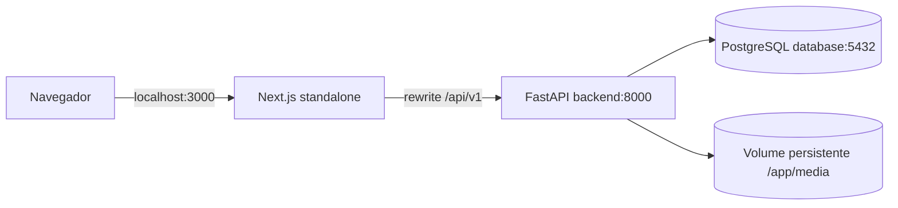
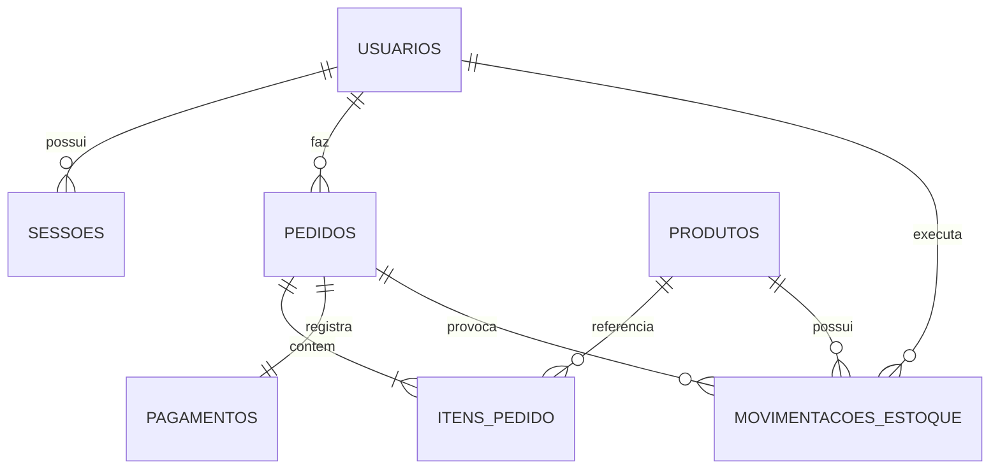
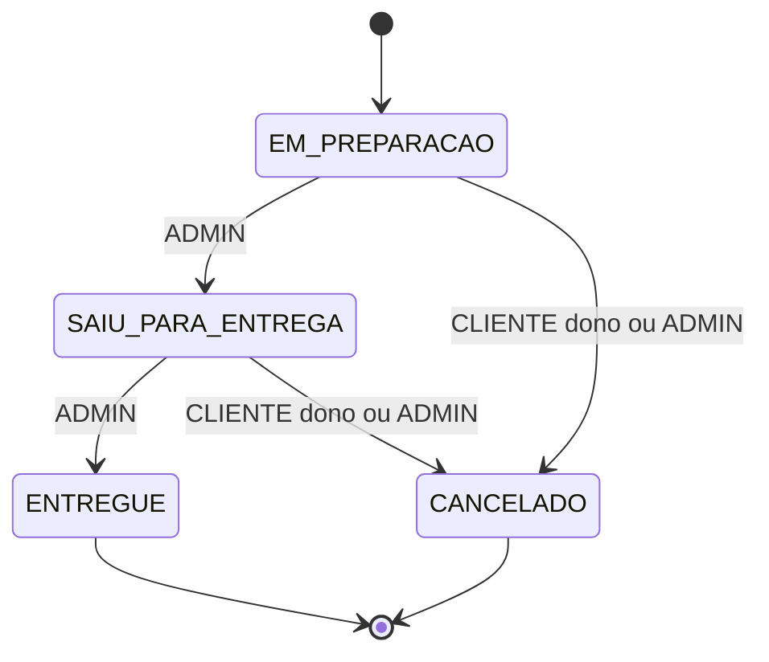

# PROJECT_SPEC — Cupcake Store

> **Especificação executável para Claude Code, GitHub Copilot ou outro agente de desenvolvimento.**
>
> **Versão da especificação:** 1.0 — 25/10/2026  
> **Idioma do sistema:** Português do Brasil (pt-BR)  
> **Natureza:** trabalho acadêmico de Engenharia de Software; aplicação demonstrativa integralmente funcional.  
> **Status:** escopo funcional, arquitetura e UX consolidados. Implementar, executar, testar e corrigir; não criar funcionalidades fora deste documento.

---

## 0. CONTRATO OBRIGATÓRIO PARA O AGENTE IMPLEMENTADOR

**Leia o documento inteiro antes de escrever código.** Ele é a fonte de verdade para requisitos, contratos e aceitação. Implemente no repositório uma aplicação completa, sem deixar telas vazias, rotas simuladas, TODOs de funcionalidades ou dados hardcoded em relatórios. O alvo não é produzir uma proposta ou mais documentação: **entregue código executável e validado**.

1. **Code first:** construir a aplicação antes da documentação acadêmica derivada dela. Não escrever dissertação, diagramas acadêmicos extensos ou relatórios fictícios antes de existir código funcional. Depois, um `README.md` objetivo e documentação que reflita o código realmente implementado.
2. **KISS + YAGNI:** apenas três serviços Docker: `frontend` (Next.js), `backend` (FastAPI), `database` (PostgreSQL). Monólito Python, MVC pragmático, SQLAlchemy síncrono. **Proibidos:** microsserviços, Redis, filas, Celery, DDD/CQRS, repository pattern genérico, event sourcing, Kubernetes, Nginx, serviços de nuvem, pagamentos reais, SDKs de gateway, WebSocket e infraestrutura extra.
3. **Não parar quando o código compilar:** subir tudo com Docker, rodar migrations/seed, executar pytest, verificações de código, build Next.js, Playwright, verificar screenshots e corrigir erros encontrados. A tarefa só estará pronta conforme os critérios da seção 21.
4. **Não perguntar sobre decisões já tomadas**. Em ambiguidade menor, adotar a implementação mais simples consistente com este documento, registrar resumidamente a decisão e seguir. **Não mudar** entidades, estados de pedido, contratos, rotas ou identidade visual por iniciativa própria.
5. **Nunca alegar que executou algo que não executou**. Registrar comandos, saídas e testes realmente executados. Se o ambiente bloquear alguma etapa, relatar o bloqueio específico, sem encobri-lo.
6. **Sem mocks em produção.** Seeds determinísticos de produtos e credencial de demonstração configurada por ambiente são permitidos. Dados dinâmicos das páginas devem vir da API/PostgreSQL; o carrinho é a exceção explicitamente local.
7. **Sem segredos versionados.** Senhas administrativas e do banco vêm de `.env` não commitado. Fornecer `.env.example` e documentação clara. Jamais colocar senhas reais no README, nos scripts de seed ou em screenshots.
8. **Uma solução simples também deve ser robusta:** transações, idempotência do checkout, rollback, autorização no backend, estoque não negativo, persistência, erros claros e responsividade são requisitos, não extras.

### 0.1. Definição do produto

**Cupcake Store** é uma loja web responsiva de cupcakes, com catálogo público, carrinho local, registro de usuário, autenticação por sessão, pedidos com pagamento exclusivamente demonstrativo, acompanhamento/cancelamento pelo cliente e painel administrativo com produtos, estoque, pedidos e relatórios. É uma demonstração, **não** um meio de receber dinheiro ou oferecer entrega real. Não criar app mobile nativo; a demonstração mobile ocorrerá via navegador/Chrome DevTools.

### 0.2. Escopo NÃO incluído

Nenhuma cobrança, Pix QR Code, campos de cartão, CVV, checkout externo, reembolso, frete, cálculo tributário, cupons, fidelidade, reviews, chat, notificações, previsão de entrega, rastreamento GPS, geocoding, ViaCEP, múltiplos endereços, categorias de produtos, favoritos, recuperação de senha por e-mail/SMS, login social, 2FA, gerenciamento de ingredientes, exportação XLS/PDF, agendamento de relatórios ou BI. **Uma única loja, um único catálogo, BRL, pt-BR.**

---

## 1. TECNOLOGIA, VERSÕES E REPRODUTIBILIDADE

| Camada | Escolha obrigatória |
|---|---|
| Frontend | Next.js **App Router**, TypeScript `strict`, React, Tailwind CSS, componentes shadcn/ui selecionados |
| Visualização | Recharts somente para gráficos; ícones Lucide React |
| Formulários | React Hook Form + Zod; máscaras leves implementadas localmente |
| HTTP | `fetch` nativo; cliente HTTP compartilhado, sem Axios obrigatório |
| Estado | React Context (`AuthProvider`, `CartProvider`) e estado local; sem Redux/React Query |
| Backend | Python **3.12**, FastAPI, Pydantic v2, Uvicorn |
| ORM/migrations | SQLAlchemy **2.x síncrono**, Alembic |
| Dependências Python | Poetry 2.x, `package-mode = false`, `poetry.lock` commitado |
| Banco | PostgreSQL 17, persistente |
| Servidor web | Node.js 24 LTS, Next.js `output: 'standalone'`; sem Nginx |
| Testes backend | pytest + HTTPX; banco PostgreSQL separado de testes |
| Testes frontend | Playwright E2E; `tsc --noEmit`, lint, `next build` |
| Qualidade Python | pre-commit com black, isort, flake8 e mypy; hooks utilitários |
| Contêineres | Docker Compose, exatamente `frontend`, `backend`, `database` |

**Baseline verificada em 25/10/2026:** Next.js **16.4.3** e FastAPI **0.162.0** estão disponíveis em versões estáveis; SQLAlchemy **2.0.55** é uma versão da linha 2.0. Fixar essas versões na configuração inicial. Para React, Tailwind, shadcn/ui, Recharts, Alembic, Pydantic, Poetry e ferramentas de testes, escolher versões estáveis compatíveis, fixar as versões **exatas resolvidas** em `frontend/package-lock.json` e `backend/poetry.lock`, e **não** usar `latest`, versões canary/beta nem ranges livres na entrega. **Testar o conjunto escolhido**, sem presumir compatibilidade pela versão.

**Atenção Next.js 16:** não copiar exemplos obsoletos de versões antigas; seguir APIs estáveis do App Router e os comandos de lint efetivamente disponíveis na versão instalada. Declarar scripts explícitos de `lint`, `typecheck`, `build`, `test:e2e`.

**Não usar versão de Python diferente da 3.12** sem necessidade técnica real. No Docker, usar bases Node 24 LTS e Python 3.12, documentando os tags e, se viável, digests exatos verificados. Nenhuma dependência deve ser buscada dinamicamente no momento de servir uma página.

### 1.1. Convenções

- JSON/API em `snake_case`; tipos TS representam os campos recebidos sem traduções arbitrárias. Componentes em PascalCase; arquivos e funções Python em snake_case.
- IDs de usuários, produtos, pedidos e movimentos são `BIGINT` do banco, representados por números no JSON; adequados ao volume acadêmico.
- UTC em `TIMESTAMPTZ`; interface e filtro de relatórios em `America/Sao_Paulo`.
- Preços em PostgreSQL `NUMERIC(10,2)` / Python `Decimal` / **string decimal** em JSON (`"12.90"`) / **inteiros em centavos** para somas no frontend. `Intl.NumberFormat('pt-BR', { style: 'currency', currency: 'BRL' })` apenas para renderização. Nunca somar dinheiro com floats.
- E-mail normalizado (trim + lowercase) antes da unicidade; CEP 8 dígitos e telefone 10/11 dígitos (somente números no banco/API); UF entre siglas brasileiras válidas.
- Mensagens, labels, acessibilidade e textos de negócio em pt-BR.

---

## 2. ARQUITETURA E EXECUÇÃO



### 2.1. Containers e rede

- `frontend`: Next standalone em porta 3000, única interface pública principal.
- `backend`: FastAPI na porta 8000 **da rede Docker**. Para facilitar Swagger durante o desenvolvimento, publicar **opcionalmente e somente em loopback** `127.0.0.1:8000:8000`; jamais `0.0.0.0:8000` na configuração demonstrativa. Swagger em `http://127.0.0.1:8000/docs`, se mapeado.
- `database`: PostgreSQL na rede Compose; **não publicar** 5432 no host por padrão.
- Volumes nomeados independentes para `postgres_data` e `product_media`.
- Não expor segredos ao bundle do navegador, nem configurar `NEXT_PUBLIC_API_URL` com hostname Docker.

### 2.2. Proxy SAME-ORIGIN obrigatório

O navegador sempre consulta URLs relativas, por exemplo `fetch('/api/v1/auth/me', {credentials:'same-origin'})`. Configurar um `rewrite` Next.js para `/api/v1/:path*` → `http://backend:8000/api/v1/:path*`, usando rede Docker (o hostname `backend` não existe no navegador). Validar **na build standalone real** propagação de cookies, `Set-Cookie`, multipart upload, query string, headers `Idempotency-Key` e `Origin`.

Não utilizar base URLs diferentes em componentes; cliente HTTP único. Priorizar chamadas browser-side nas telas protegidas para simplificar cookies e carrinho; SSR protegido só se o encaminhamento explícito de cookies estiver corretamente implementado. Não introduzir duas implementações de autenticação.

### 2.3. Inicialização determinística

**Após configuração local do `.env`, o único comando para iniciar os serviços deve ser:**

```bash
docker compose up -d --build
```

Fluxo de startup:

1. `database` sobe com `healthcheck` via `pg_isready`.
2. `backend` espera banco saudável, executa `alembic upgrade head`, **seed idempotente** de admin/produtos/imagens e só então inicia Uvicorn. Migrations com falha devem impedir inicialização saudável do backend.
3. `backend` disponibiliza um endpoint **técnico** `GET /health` retornando 200 apenas se app e DB estiverem disponíveis (não contar como endpoint de negócio).
4. `frontend` sobe com Next.js standalone e consegue consultar backend. Adicionar healthcheck ou dependência simples coerente para evitar página utilizável antes da API.
5. Reiniciar os três contêineres não deve duplicar dados nem apagar imagens.

O banco pode iniciar vazio. **Nunca usar `create_all()` como substituto do Alembic** na aplicação final. Utilizar única migration inicial coerente com o modelo e aplicar via upgrade.

`.env.example` contém *nomes* de variáveis com valores de desenvolvimento não secretos ou placeholders, incluindo `DATABASE_URL`, `POSTGRES_DB`, `POSTGRES_USER`, `POSTGRES_PASSWORD`, `ADMIN_EMAIL`, `ADMIN_PASSWORD`, `APP_ENV`, `FRONTEND_ORIGIN`, `COOKIE_SECURE`. Arquivo `.env` ignorado pelo Git; documentar `cp .env.example .env`, preenchimento dos segredos e execução. **Sem credencial de administrador embutida.** Configuração inválida de ADMIN_EMAIL/ADMIN_PASSWORD deve emitir erro claro de setup, sem imprimir a senha. Não sobrescrever administrador existente ao reiniciar.

---

## 3. AUTENTICAÇÃO, AUTORIZAÇÃO E SEGURANÇA

### 3.1. Papéis

`CLIENTE` e `ADMIN`. Cadastro público sempre cria `CLIENTE`. Administrador é criado via seed usando email e senha definidos exclusivamente por variáveis de ambiente. O `ADMIN` é enviado por padrão ao `/admin`, não usa checkout de consumidor. Permissões **sempre** confirmadas no backend, mesmo que o frontend esconda menus.

### 3.2. Sessão opaque token

- Login gera `secrets.token_urlsafe(32)` (token aleatório forte), grava **apenas `SHA-256(token)`** em `sessoes.token_hash`, validade 8h UTC, e devolve token bruto **somente em cookie HttpOnly**.
- Cookie sugerido `cupcake_session`, `HttpOnly`, `SameSite=Lax`, `Path=/`, `Secure=true` em HTTPS, `Secure=false` apenas no ambiente local HTTP. `Max-Age=28800`, correspondente à expiração real no banco. Não definir atributo `Domain` desnecessário (host-only).
- `get_current_user` lê cookie, calcula hash, busca sessão, exige não revogada, não expirada e usuário ativo; caso contrário 401. `require_admin` verifica o perfil, retorna 403. Nunca retornar hashes/token nos schemas públicos.
- `POST /auth/logout` revoga a sessão encontrada e limpa cookie, **idempotente, resposta 204**. Expiração pode limpar cookie no browser.
- `PUT /users/me/password` verifica senha atual, usa Argon2 para nova senha, revoga **todas** as sessões, limpa cookie e retorna 204; frontend redireciona para novo login.
- `GET /auth/me` é a rota de **usuário atualmente autenticado**, não uma variável especial do framework. `PATCH /users/me` edita sempre o próprio usuário identificado pela sessão.
- Argon2id por biblioteca madura compatível com Python/Passlib ou `argon2-cffi`; senha mínima de 12 caracteres. Não permitir senha atual = nova senha.

### 3.3. CSRF, CORS, navegação

- Requisições do navegador à API são **same-origin** via rewrite. CORS middleware **não habilitado** por padrão.
- Verificar `Origin` em toda rota que modifica estado (`POST`, `PATCH`, `PUT`, `DELETE` se houver). Comparar com lista explícita de origens de frontend permitidas (`http://localhost:3000` em dev); recusar Origin inesperado com 403 `INVALID_ORIGIN`. Tratar ausência de Origin de forma conservadora nas operações com cookie: recusar mutações de browser sem Origin confiável; testes HTTPX devem incluir Origin. Em acesso direto ao Swagger de desenvolvimento em `127.0.0.1:8000/docs`, permitir explicitamente essa origem **somente em dev**, se necessário; não abrir wildcard.
- Next rewrite precisa preservar corretamente `Origin` e `Set-Cookie`, validado em teste de integração. `SameSite=Lax` é defesa adicional, não substitui validação de origem.
- Nunca armazenar tokens/senhas no `localStorage`, `sessionStorage` ou query string. Apenas carrinho e chave de idempotência são armazenados no navegador.
- Redirecionamento pós-login (`next`) e `returnTo` do perfil aceitam apenas caminhos internos de uma allowlist (`/`, `/checkout`, `/orders`, `/orders/<id>`, `/account`, `/admin` quando autorizado); bloquear `//`, esquemas externos e URLs absolutas.
- Respostas de dados privados com `Cache-Control: no-store`; não compartilhar cache autenticado entre usuários; não registrar senhas, cookie ou token em logs.
- Mensagens de login inválido genéricas; não diferenciar email inexistente de senha incorreta.

### 3.4. Modelo de erro padronizado

Erros de negócio sempre:

```json
{"detail":{"code":"INSUFFICIENT_STOCK","message":"Estoque insuficiente para o produto.","details":{"produto_id":1,"quantidade_disponivel":2}}}
```

`details` opcional ou `{}`. Para validação 422, adaptar o erro padrão do Pydantic para um formato consumível e seguro pelo frontend (idealmente `code=VALIDATION_ERROR`, `details.fields` com nomes e mensagens humanizadas). Nunca vazar exception, SQL ou traceback. Cliente HTTP único converte status+code em mensagens específicas por formulário. Categorias mínimas: `VALIDATION_ERROR` (422), `INVALID_CREDENTIALS` (401), `UNAUTHENTICATED` (401), `FORBIDDEN` (403), `INVALID_ORIGIN` (403), `NOT_FOUND` (404), `EMAIL_ALREADY_EXISTS` (409), `SLUG_ALREADY_EXISTS` (409), `PRICE_CHANGED` (409), `INSUFFICIENT_STOCK` (409), `PRODUCT_UNAVAILABLE` (409), `IDEMPOTENCY_CONFLICT` (409), `INVALID_STATUS_TRANSITION` (409), `STOCK_CONFLICT` (409). Falha inesperada 500 usa mensagem genérica.

---

## 4. MODELO FÍSICO POSTGRESQL: EXATAMENTE SETE TABELAS

Usar `BIGINT GENERATED BY DEFAULT AS IDENTITY` (ou `BIGSERIAL` de forma consistente), PK, FKs, `CHECK`, índices e `TIMESTAMPTZ`. Criar models SQLAlchemy e migration Alembic equivalentes. `criado_em` e `atualizado_em` com UTC; atualizar `atualizado_em` nas alterações. Recomendado `ON DELETE RESTRICT` para relações históricas, sem exclusão física de usuários/produtos/pedidos.

### 4.1. `usuarios`

| Coluna | Tipo/regra |
|---|---|
| `id` | BIGINT PK |
| `nome_completo` | VARCHAR(150) NOT NULL |
| `telefone` | VARCHAR(20) NOT NULL, 10 ou 11 dígitos após normalização |
| `email` | VARCHAR(255) NOT NULL UNIQUE, lowercase/trim |
| `senha_hash` | VARCHAR(255) NOT NULL |
| `perfil` | VARCHAR(10) NOT NULL DEFAULT 'CLIENTE'; CHECK IN ('CLIENTE','ADMIN') |
| `cep` | CHAR(8) NOT NULL |
| `logradouro` | VARCHAR(150) NOT NULL |
| `numero` | VARCHAR(20) NOT NULL |
| `complemento` | VARCHAR(100) NULL |
| `bairro` | VARCHAR(100) NOT NULL |
| `cidade` | VARCHAR(100) NOT NULL |
| `uf` | CHAR(2) NOT NULL |
| `ativo` | BOOLEAN NOT NULL DEFAULT true |
| `criado_em`, `atualizado_em` | TIMESTAMPTZ NOT NULL |

Seed do `ADMIN` deve incluir **endereço demonstrativo válido** e telefone fictício estruturalmente válido para satisfazer NOT NULL; a senha deve vir de env, jamais do Git. Cliente registra endereço completo no cadastro. E-mail imutável no MVP. Endereço modelado como campos SQL planos, mas serializado em objeto JSON `endereco`.

### 4.2. `sessoes`

| Coluna | Tipo/regra |
|---|---|
| `id` | BIGINT PK |
| `usuario_id` | BIGINT NOT NULL FK `usuarios.id` |
| `token_hash` | CHAR(64) NOT NULL UNIQUE |
| `expira_em` | TIMESTAMPTZ NOT NULL |
| `revogada_em` | TIMESTAMPTZ NULL |
| `criado_em` | TIMESTAMPTZ NOT NULL |

Índice `(usuario_id, expira_em)`. Não armazenar token bruto; remover sessões expiradas **não** requer job automático para MVP.

### 4.3. `produtos`

| Coluna | Tipo/regra |
|---|---|
| `id` | BIGINT PK |
| `slug` | VARCHAR(140) NOT NULL UNIQUE, estável |
| `nome` | VARCHAR(150) NOT NULL |
| `descricao` | TEXT NOT NULL, validação de até 2.000 caracteres |
| `preco` | NUMERIC(10,2) NOT NULL CHECK (`preco > 0`) |
| `imagem_path` | TEXT NOT NULL, relativo a raiz segura de mídia |
| `quantidade_estoque` | INTEGER NOT NULL DEFAULT 0 CHECK (`quantidade_estoque >= 0`) |
| `ativo` | BOOLEAN NOT NULL DEFAULT true |
| `criado_em`, `atualizado_em` | TIMESTAMPTZ NOT NULL |

Um único arquivo de imagem por produto. `PATCH /admin/products/{id}` **não** recebe estoque, nem slug. Sem DELETE; usar `ativo=false`. Produto ativo e estoque zero continua visível como esgotado.

### 4.4. `pedidos`

| Coluna | Tipo/regra |
|---|---|
| `id` | BIGINT PK |
| `usuario_id` | BIGINT NOT NULL FK `usuarios.id` |
| `status` | VARCHAR(25) NOT NULL DEFAULT 'EM_PREPARACAO'; CHECK em quatro estados |
| `valor_total` | NUMERIC(10,2) NOT NULL CHECK (`valor_total > 0`) |
| `telefone_entrega` | VARCHAR(20) NOT NULL |
| `cep_entrega` | CHAR(8) NOT NULL |
| `logradouro_entrega` | VARCHAR(150) NOT NULL |
| `numero_entrega` | VARCHAR(20) NOT NULL |
| `complemento_entrega` | VARCHAR(100) NULL |
| `bairro_entrega` | VARCHAR(100) NOT NULL |
| `cidade_entrega` | VARCHAR(100) NOT NULL |
| `uf_entrega` | CHAR(2) NOT NULL |
| `chave_idempotencia` | UUID NOT NULL |
| `hash_requisicao` | CHAR(64) NOT NULL |
| `criado_em`, `atualizado_em` | TIMESTAMPTZ NOT NULL |
| `entregue_em` | TIMESTAMPTZ NULL |
| `cancelado_em` | TIMESTAMPTZ NULL |
| `cancelado_por` | BIGINT NULL FK `usuarios.id` |
| `motivo_cancelamento` | VARCHAR(255) NULL |

Índices `(usuario_id,criado_em DESC)` e `(status,criado_em DESC)`. `UNIQUE (usuario_id,chave_idempotencia)` **obrigatório**. CHECK de coerência: `ENTREGUE` exige `entregue_em` não nulo e campos de cancelamento nulos; `CANCELADO` exige `cancelado_em`, `cancelado_por` não nulos e `entregue_em` nulo; estados em andamento mantêm timestamps finais nulos. Motivo pode ser nulo. Snapshot de endereço **não se altera** após a compra.

### 4.5. `itens_pedido`

`id` BIGINT PK; `pedido_id` BIGINT FK NOT NULL; `produto_id` BIGINT FK NOT NULL; `nome_produto` VARCHAR(150) NOT NULL; `quantidade` INTEGER NOT NULL CHECK >0; `preco_unitario` NUMERIC(10,2) NOT NULL CHECK >0; `UNIQUE(pedido_id,produto_id)`. Nome e preço armazenados **no momento do checkout**. Quantidade e totais históricos não dependem de alterações posteriores do catálogo.

### 4.6. `pagamentos`

`id` BIGINT PK; `pedido_id` BIGINT NOT NULL FK UNIQUE; `forma_pagamento` VARCHAR(15) NOT NULL CHECK IN ('PIX','CARTAO','DINHEIRO'); `valor` NUMERIC(10,2) NOT NULL CHECK >0; `registrado_em` TIMESTAMPTZ NOT NULL. **Somente registro demonstrativo.** Não inventar `status_aprovado`, transação bancária ou reembolso. Cancelamento preserva esse registro.

### 4.7. `movimentacoes_estoque`

`id` BIGINT PK; `produto_id` BIGINT NOT NULL FK; `pedido_id` BIGINT NULL FK; `usuario_id` BIGINT NULL FK; `tipo` VARCHAR(20) NOT NULL CHECK IN ('INICIAL','VENDA','CANCELAMENTO','AJUSTE'); `variacao` INTEGER NOT NULL CHECK !=0; `observacao` VARCHAR(255) NULL; `criado_em` TIMESTAMPTZ NOT NULL. Índice `(produto_id, criado_em DESC)`. Índice UNIQUE parcial `(pedido_id, produto_id, tipo)` quando `tipo IN ('VENDA','CANCELAMENTO')` e `pedido_id IS NOT NULL` para impedir lançamentos duplicados. Também aplicar validação coerente de sinal: `INICIAL` e `CANCELAMENTO` positivos, `VENDA` negativo e `AJUSTE` não zero, de qualquer sinal. No cadastro com estoque inicial **zero**, não registrar movimento `INICIAL` com variação zero (a quantidade inicial continua 0); criar movimento apenas se quantidade inicial >0. Em ajustes, `usuario_id` é o administrador autenticado; nas vendas/cancelamentos, usar usuário que executou quando aplicável, com pedido associado.

### 4.8. Resumo das entidades



**Não criar tabela de carrinho, categorias, endereços, notificações ou histórico de status**. O acompanhamento mostra estágio atual, não timestamps fictícios de cada transição.

---

## 5. REGRAS TRANSACIONAIS DO DOMÍNIO

### 5.1. Estados permitidos



Somente ADMIN avança; o cliente cancela somente pedido próprio; ADMIN cancela qualquer pedido elegível. `ENTREGUE` e `CANCELADO` são terminais. Nada de retrocesso ou restauração de cancelado. Na entrega preencher `entregue_em`; no cancelamento preencher `cancelado_em`, `cancelado_por` e motivo opcional.

### 5.2. Checkout ACID + preços

Fluxo obrigatório numa única transação:

1. Autenticar e exigir `CLIENTE`. Validar `Idempotency-Key` UUID obrigatório e payload com 1+ itens, IDs únicos, quantidades positivas, forma de pagamento válida, preços esperados string decimal positiva.
2. **Serializar checkouts simultâneos do mesmo usuário** com `SELECT ... FOR UPDATE` na linha do usuário. É suficiente para o pequeno volume acadêmico e torna a idempotência fácil de raciocinar; seguir para a verificação da chave **ANTES** das regras de estoque/preço.
3. Canonicalizar payload (itens ordenados por `produto_id`, campos tipados e preços normalizados a duas casas; incluir forma de pagamento; não incluir campos derivados como endereço ou data) e calcular SHA-256 do JSON canônico. Se já existir `(usuario_id,chave_idempotencia)`: hash igual → **devolver pedido existente (HTTP 200)** sem recalcular estoque/preço ou recriar pagamento/movimentos; hash diferente → `409 IDEMPOTENCY_CONFLICT`.
4. Para pedido novo, obter produtos `FOR UPDATE` em **ordem crescente de ID**, verificar que todos existem, ativos, preços iguais ao preço esperado e estoque suficiente. Preço divergente → `409 PRICE_CHANGED` com ID, preço esperado e novo preço. Inativo/inexistente → `409 PRODUCT_UNAVAILABLE`; estoque insuficiente → `409 INSUFFICIENT_STOCK`, com quantidade disponível. Não efetuar mutação parcial.
5. Copiar endereço/telefone atuais do usuário para `pedidos`. Calcular total exclusivamente com preços Decimal do banco; criar pedido `EM_PREPARACAO`, itens com snapshots, pagamento demonstrativo, debitar estoque e inserir movimentos `VENDA` negativos.
6. `COMMIT` atômico; resposta `201 Created` com detalhe completo. Qualquer erro → rollback. UNIQUE de idempotência como proteção adicional.
7. Outro checkout novo concomitante do mesmo usuário pode ocorrer depois do primeiro, com chave **distinta**, e deve respeitar o saldo atualizado. Pedidos de usuários diferentes se serializam pelos locks ordenados de produtos.

**Risco crítico resolvido:** se a rede cair **depois do COMMIT**, retry com a mesma chave+payload retorna pedido existente antes de conferir estoque. Não tentar compra nova nem negar apenas porque o estoque ficou menor.

### 5.3. Idempotência no navegador

`sessionStorage` contém `{key, fingerprint}` da tentativa lógica. `fingerprint` deriva deterministicamente dos itens ordenados, quantidades, preços esperados e forma de pagamento (não é token de autenticação). A mesma tentativa mantém UUID após timeout e recarregamento. Mudança de itens, quantidade, preço aceito ou método cria nova tentativa/chave. Bloquear cliques simultâneos. Em `201` **ou** `200` de recuperação confirmada: limpar carrinho e chave; redirecionar `/orders/{id}?created=1`. Em erro/timeout incerto: **não limpar carrinho** e não gerar nova chave automaticamente. Para editar os dados após resultado incerto, informar necessidade de verificar pedido anterior, evitando duplicidade inadvertida.

### 5.4. Cancelamento ACID + estoque

- Abrir transação e bloquear linha de `pedidos` (`FOR UPDATE`). Verificar titularidade para cliente, perfil para admin, e estado elegível.
- Bloquear linhas de `produtos` envolvidos em ordem crescente de ID; atualizar pedido para `CANCELADO`, gravar autor/data/motivo, incrementar estoque **uma única vez** por item, inserir movimentos `CANCELAMENTO` positivos vinculados ao pedido e confirmar tudo atomicamente.
- Se entrega ou cancelamento venceu a corrida, retornar `409 INVALID_STATUS_TRANSITION`, atualizar tela e **não** alterar estoque. Cancelamento repetido não deve devolver estoque novamente (índice parcial e status terminal ajudam).
- Pagamento demonstrativo permanece registrado, sem operação de estorno.

### 5.5. Ajuste manual de estoque

ADMIN usa `POST /admin/products/{id}/stock-adjustments` com `variacao` inteira !=0 e `observacao` obrigatória 3..255 caracteres. Trancar produto, calcular `novo_saldo` no DB, rejeitar saldo negativo (`409 STOCK_CONFLICT`, ou `INSUFFICIENT_STOCK` de forma consistente), atualizar e registrar `AJUSTE` na **mesma transação**. Não permitir alterar estoque por `PATCH /admin/products` nem editar/deletar movimentos. Frontend mostra entrada/saída como números positivos e converte o sinal.

Sem idempotency key em ajuste manual. Em timeout com resultado incerto **não reenviar automaticamente**; consultar saldo e histórico primeiro.

### 5.6. Logística

Entrega **100% demonstrativa**: qualquer endereço brasileiro estruturalmente válido pode ser cadastrado. Sem taxa de frete, prazo estimado, limite de cobertura ou transportadora. O administrador altera manualmente os status. Não prometer entrega real. Isso não altera checkout, valor total ou relatório.

---

## 6. PADRÕES GERAIS DA API

Prefixo de negócio: `/api/v1`. JSON UTF-8, `snake_case`, paginação `limit` + `offset`. Resposta padrão de listagens paginadas:

```json
{"items":[],"total":0,"limit":20,"offset":0}
```

`limit` default 20, máximo 100 (histórico do cliente usa 10 por decisão de UX); `offset>=0`. Datas ISO 8601 com timezone. Decimais como strings `"12.90"`; IDs inteiros. Métodos GET apenas leitura, POST cria/transiciona, PATCH atualiza parcialmente, PUT troca recurso de imagem ou senha conforme contrato. Requisições sem cookie em áreas restritas 401; CLIENTE em rota ADMIN 403. Para detalhes de pedido alheio, devolver 404 em vez de revelar existência. `Cache-Control: no-store` para autenticados.

### 6.1. Schemas canônicos compartilhados (contrato lógico)

**`Endereco`:** `{cep,logradouro,numero,complemento,bairro,cidade,uf}`; `complemento` pode ser null. **`UsuarioPublico`:** `{id,nome_completo,telefone,email,perfil,endereco,ativo,criado_em}` — sem hash/sessões. **`ProdutoPublico`:** `{id,slug,nome,descricao,preco,imagem_url,quantidade_estoque,ativo}` — nos endpoints públicos `ativo` sempre true, no admin pode false; `imagem_url` relativo `/api/v1/products/{id}/image`, sem expor caminho físico interno. **`ItemPedido`:** `{produto_id,nome_produto,quantidade,preco_unitario,subtotal}`; **`PagamentoDemonstrativo`:** `{forma_pagamento,valor,registrado_em}`; **`PedidoDetalhe`:** `{id,usuario_id,status,valor_total,criado_em,atualizado_em,entregue_em,cancelado_em,cancelado_por,motivo_cancelamento,cliente:{id,nome_completo,email},entrega:{telefone,cep,logradouro,numero,complemento,bairro,cidade,uf},itens:[ItemPedido],pagamento:PagamentoDemonstrativo}`. `cliente` usa nome cadastral atual; apenas endereço/telefone e itens/preços são snapshots. `PedidoResumo`: campos principais + nome cliente quando ADMIN, `quantidade_itens`, forma de pagamento.

**Todos os nomes de campo no frontend devem ser os mesmos dos schemas Pydantic implementados.** Criar tipos TS que espelhem estes modelos; testes de contrato devem detectar divergências.

---

## 7. CONTRATOS REST: 27 ENDPOINTS DE NEGÓCIO

### 7.1. Autenticação e usuários — 6

| Método | Rota | Perfil | Requisição / Resposta / regras |
|---|---|---|---|
| POST | `/auth/register` | Público | `{nome_completo,telefone,email,senha,endereco}`; cria CLIENTE e sessão/cookie; `201 UsuarioPublico`; e-mail duplicado 409 |
| POST | `/auth/login` | Público | `{email,senha}` → `200 UsuarioPublico` + cookie; credenciais inválidas 401 genérico |
| POST | `/auth/logout` | Público/sessão | sem payload; revogar quando existir e limpar cookie; 204 idempotente |
| GET | `/auth/me` | Logado | `200 UsuarioPublico` com endereço; 401 sem sessão |
| PATCH | `/users/me` | Logado | atualização parcial de `{nome_completo?,telefone?,endereco?}`; se `endereco` presente, objeto completo válido; email não editável; `200 UsuarioPublico` |
| PUT | `/users/me/password` | Logado | `{senha_atual,nova_senha}`; validar, Argon2, revogar todas as sessões; 204 e limpar cookie |

Exemplo de cadastro:

```json
{"nome_completo":"Ana Silva","telefone":"11999999999","email":"ana@example.com","senha":"SenhaForte2026!","endereco":{"cep":"01310100","logradouro":"Avenida Paulista","numero":"100","complemento":"Apto 12","bairro":"Bela Vista","cidade":"São Paulo","uf":"SP"}}
```

Regras: nome 3..150, senha >=12, telefone 10/11 dígitos, CEP 8, UF válida, número obrigatório; e-mail case-insensitive. Não incluir `perfil` ou `ativo` em request de registro. Confirmar senha apenas no frontend, **não enviar à API**.

### 7.2. Produtos e imagens — 8

| Método | Rota | Acesso | Regras |
|---|---|---|---|
| GET | `/products?search=&limit=20&offset=0` | Público | lista paginada **ativos**; busca nome/descrição, inclui esgotados; ordem nome, ID |
| GET | `/products/{slug}` | Público | detalhe de produto ativo; 404 se inexistente/inativo |
| GET | `/products/{id}/image` | Público | serve arquivo persistido, fallback padrão local; sem path traversal |
| GET | `/admin/products?search=&ativo=&limit=20&offset=0` | ADMIN | inclui ativos e inativos; `ativo` omitido=todos; ordenação nome/ID |
| GET | `/admin/products/{id}` | ADMIN | detalhes para edição |
| POST | `/admin/products` | ADMIN | `{nome,descricao,preco,quantidade_inicial}`; slug gerado estável, imagem padrão, movimento INICIAL se quantidade>0; 201 |
| PATCH | `/admin/products/{id}` | ADMIN | `{nome?,descricao?,preco?,ativo?}`; 200; **sem estoque/slug** |
| PUT | `/admin/products/{id}/image` | ADMIN | multipart `file`; JPG/PNG/WebP <=3 MiB, validar conteúdo real com Pillow, nome seguro gerado no servidor, persistir imagem e responder produto atualizado |

Nota: `imagem_url` é rota pública, mesmo para imagem eventualmente usada por item de pedido de produto depois desativado; catálogo público não pode listar produtos inativos. `slug` derivado do nome no cadastro (normalizar acentos e hífens); colisão → `409 SLUG_ALREADY_EXISTS` em vez de alteração silenciosa do nome. Imagem padrão deve existir no repositório. Frontend cadastra JSON antes de upload e **não** recria produto se upload posterior falhar.

### 7.3. Pedidos — 7

| Método | Rota | Acesso | Regras |
|---|---|---|---|
| POST | `/orders` | CLIENTE | `Idempotency-Key: UUID` + checkout; 201 novo ou 200 repetido idêntico |
| GET | `/orders?limit=10&offset=0` | CLIENTE | somente próprios, recentes primeiro, paginado |
| GET | `/orders/{id}` | CLIENTE dono | detalhe; não dono/inexistente 404 |
| POST | `/orders/{id}/cancel` | Dono CLIENTE ou ADMIN | `{motivo_cancelamento?}`; elegível apenas em preparo/transporte; transação/restock; 200 PedidoDetalhe |
| GET | `/admin/orders?status=&data_inicio=&data_fim=&limit=20&offset=0` | ADMIN | todos os pedidos, recentes primeiro, com nome cliente |
| GET | `/admin/orders/{id}` | ADMIN | detalhes completos |
| PATCH | `/admin/orders/{id}/status` | ADMIN | `{status:"SAIU_PARA_ENTREGA"}` ou `{status:"ENTREGUE"}` na ordem correta; nunca CANCELADO por aqui; 200 PedidoDetalhe |

Request checkout:

```http
POST /api/v1/orders
Idempotency-Key: 2bd46936-e805-422a-9c04-b8c8c04e9aab
Content-Type: application/json
```

```json
{"items":[{"produto_id":1,"quantidade":2,"preco_unitario_esperado":"12.90"},{"produto_id":2,"quantidade":1,"preco_unitario_esperado":"14.90"}],"forma_pagamento":"PIX"}
```

Não aceitar `valor_total` ou `usuario_id` enviados pelo navegador. Endereço do pedido vem exclusivamente do usuário no banco. Checar preço, saldo e permissão dentro da transação. Pagamento `PIX`, `CARTAO`, `DINHEIRO`, somente rótulo demonstrativo. Cliente e admin cancelam com mesmo endpoint; admin autorizado a cancelar pedido de terceiros. No cancelamento entregue, `409 INVALID_STATUS_TRANSITION`.

### 7.4. Estoque — 2

| Método | Rota | Acesso | Regras |
|---|---|---|---|
| POST | `/admin/products/{id}/stock-adjustments` | ADMIN | `{variacao: -5, observacao:"Produtos danificados"}`; transação + movimento AJUSTE; 200 produto atualizado ou resumo de saldo com IDs |
| GET | `/admin/products/{id}/stock-movements?limit=20&offset=0` | ADMIN | paginado por data desc; `{id,tipo,variacao,observacao,pedido_id,usuario_id,criado_em}` |

Produto não existe 404. Entrada/saída só diferem pelo sinal. No frontend usuário insere magnitude positiva com seletor Entrada/Saída. Saldo 0 é permitido; estoque negativo é proibido.

### 7.5. Dashboard e relatórios — 4

| Método | Rota | Acesso | Conteúdo mínimo |
|---|---|---|---|
| GET | `/admin/dashboard?data_inicio=&data_fim=` | ADMIN | total de pedidos criados por status, pedidos concluídos, soma valores concluídos, unidades entregues, ticket médio, produtos ativos, ativos estoque baixo/esgotado |
| GET | `/admin/reports/sales?data_inicio=&data_fim=&group_by=day` | ADMIN | série temporal por dia/mês de pedidos **ENTREGUE**, `pedidos`, `unidades`, `valor`; agregados totais |
| GET | `/admin/reports/products?data_inicio=&data_fim=&limit=10` | ADMIN | ranking por `produto_id`: nome exibido, quantidade, valor histórico; apenas ENTREGUE |
| GET | `/admin/reports/payments?data_inicio=&data_fim=` | ADMIN | grupo por PIX/CARTAO/DINHEIRO, quantidade e valor **demonstrativo**; inclui todos os status, inclusive cancelados |

**Contratos de resposta obrigatórios, objetos JSON diretos (SEM wrappers artificiais)**. Os valores abaixo são exemplos fictícios para demonstrar a estrutura, não devem aparecer hardcoded na UI.

**`GET /admin/dashboard`:**

```json
{
  "periodo": {"data_inicio":"2026-10-01","data_fim":"2026-10-18"},
  "pedidos_criados": 20,
  "por_status": {"EM_PREPARACAO":3,"SAIU_PARA_ENTREGA":2,"ENTREGUE":13,"CANCELADO":2},
  "pedidos_entregues": 13,
  "valor_vendas_concluidas": "458.40",
  "unidades_vendidas": 39,
  "ticket_medio": "35.26",
  "estoque": {"produtos_ativos":8,"baixo":2,"esgotados":1}
}
```

**`GET /admin/reports/sales`:**

```json
{
  "group_by":"day",
  "periodo":{"data_inicio":"2026-10-01","data_fim":"2026-10-18"},
  "totais":{"pedidos":13,"unidades":39,"valor":"458.40","ticket_medio":"35.26"},
  "series":[{"periodo":"2026-10-16","pedidos":3,"unidades":8,"valor":"90.00"}]
}
```

**`GET /admin/reports/products`:**

```json
{
  "periodo":{"data_inicio":"2026-10-01","data_fim":"2026-10-18"},
  "items":[{"produto_id":1,"nome":"Chocolate Belga","quantidade":15,"valor":"193.50"}]
}
```

**`GET /admin/reports/payments`:**

```json
{
  "periodo":{"data_inicio":"2026-10-01","data_fim":"2026-10-18"},
  "total_registros":20,
  "valor_total_demonstrativo":"695.00",
  "items":[{"forma_pagamento":"PIX","quantidade":10,"valor":"350.00"}]
}
```

Em uso real, a série de vendas deve cobrir **todos** os períodos do filtro com buckets zero, e pagamentos deve retornar linhas para as três modalidades (quantidade e valor zero para forma sem registros). As amostras resumidas acima não representam o conjunto completo da resposta para um período real. Se nenhuma venda existir, valores e arrays pertinentes devem ser válidos, jamais `NaN`.

Período default: últimos **30 dias incluindo hoje**, calculados no timezone `America/Sao_Paulo`; omitir parâmetros de data quando utilizar o default (não enviar strings vazias). Quando fornecidas, **ambas** as datas são obrigatórias e `inicio <= fim`. Limites SQL `[meia-noite início, meia-noite após fim)` convertidos para UTC; não confundir timezone do container. Todas as métricas por período usam `pedidos.criado_em` e o **status atual**. Um pedido criado num dia e entregue no seguinte entra na data da criação, assim que seu estado atual virar ENTREGUE. Contagem de pagamentos demonstrativos inclui cancelados e pendentes; **não representa dinheiro recebido**. Estoque do dashboard é atual e **não depende do filtro**. Preencher buckets diários/mensais sem vendas com zero. Evitar multiplicar `valor_total` por quantidade de itens ao fazer JOIN de pedidos com `itens_pedido`: agregar corretamente.

**Critério de exatidão:** valores de relatórios, dashboard e tabela devem coincidir para o mesmo período. Nunca dados mockados para "enfeitar" gráfico de produção.

---

## 8. IDENTIDADE VISUAL E QUALIDADE DO FRONTEND

### 8.1. Direção de arte definitiva: **Clean Boutique**

Uma confeitaria artesanal elegante, delicada e moderna; **tema CLARO fixo** independentemente de modo escuro do navegador/sistema. A loja privilegia fotos dos cupcakes, espaço em branco e legibilidade; admin privilegia dados e operação.

| Token semântico | HEX | Aplicação |
|---|---|---|
| `--color-cream` | `#FFF9F4` | **Fundo principal** das páginas |
| `--color-white` | `#FFFFFF` | Cards, inputs, modais e sidebar |
| `--color-cocoa` | `#3A2925` | Títulos, texto forte, botões primários |
| `--color-pink` | `#F4DADD` | Destaques discretos / apoio |
| `--color-sage` | `#92A28E` | Detalhes suaves, sucesso quando adequado |
| `--color-border` | `#E6D9D2` | Bordas e divisórias |
| `--color-muted` | `#796B64` | Textos secundários |
| `--color-accent` | `#9B6C6B` | Links e detalhes interativos |
| `--color-danger` | `#A24D4D` | Ações destrutivas/erros |
| `--color-success` | `#426747` | Estados concluídos/sucesso |

Implementar tokens em CSS/Tailwind. **Não usar fundo preto para a página** nem Dark Mode. O marrom cacau `#3A2925` é reservado para texto e botões, jamais para o fundo geral. Impedir alteração automática por `prefers-color-scheme: dark` (`color-scheme: light`, variantes e componentes shadcn ajustados). Contraste de texto adequado: não utilizar sálvia ou rosa claro para texto pequeno sobre branco.

**Tipografia:** fonte web legível e elegante, preferencialmente fontes de sistema para não depender de CDN. Escala coerente: H1 ~30–40px desktop / 26–30px mobile; H2 ~24–28px; corpo ~15–16px; textos auxiliares 12–14px. Cards raio 12–18px, borda fina, sombra muito leve; espaçamentos base 4/8px; container de catálogo máximo ~1200px. Botões principais com altura mínima ~44px, foco visível. Sem gradientes berrantes, autoplay, carrosséis automáticos, testimonials falsos ou ícones irrelevantes.

**Design responsivo:** testar widths 320, 390, 768, 1440px (com heights representativos 844, 1024, 900). Não deve existir overflow horizontal da página. Todo menu mobile acessível; tabelas muito densas transformadas em cards ou com overflow somente interno. Inputs em uma coluna no celular; desktop pode usar grid para cadastro/admin.

### 8.2. Padrões de componentes e estados

Reutilizar `Header`, `Footer`, `Button`, `Input`, `Textarea`, `FormField`, `PriceDisplay`, `ProductImage`, `QuantitySelector`, `OrderStatusBadge`, `OrderProgress`, `EmptyState`, `ErrorState`, `Skeleton`, `ConfirmDialog`, `Toast`, `AdminSidebar`, `AdminHeader`, `MetricCard`, `DateRangeFilter`. Usar shadcn/ui **somente para elementos que simplificam**, por exemplo Dialog, Tabs, Input, Button, Select; sem coleção gigante de componentes copiados sem uso. Lucide para ícones. Recharts para gráficos e nada mais.

Cada página precisa de estados: carregando, sucesso, vazio, erro e recuperação. Não renderizar mensagem técnica do banco. Formulários mantêm dados após falha, têm labels reais, validação próxima do input, `aria-invalid`/descrições, focus visível e indicação de ação em curso. Dialog: foco preso enquanto aberto, fecha via Escape, foco restaurado. Toast de sucesso discreto; não substituir erros de campo por toasts.

**Testes visuais obrigatórios:** screenshots de página inteira em desktop/mobile para Home, produto, carrinho, checkout, login, cadastro, perfil, pedidos cliente, dashboard admin, produtos, estoque, pedidos admin e relatórios, além dos estados vazios/modais pertinentes. Conferir screenshots visualmente, não apenas geração automática. Verificar textos cortados, imagens quebradas, contraste, posição de botões e ausência de overflow.

---

## 9. PÁGINAS PÚBLICAS E DO CLIENTE — ESPECIFICAÇÃO FECHADA

### 9.1. Inventário de rotas

| Rota | Responsabilidade | Necessita sessão? |
|---|---|---|
| `/` | Home, hero, catálogo, busca, carrinho rápido | Não |
| `/products/[slug]` | Detalhes do cupcake | Não |
| `/cart` | Carrinho local e verificação de preços/estoque | Não |
| `/checkout` | Confirmação de endereço, pagamento demonstrativo, pedido | CLIENTE |
| `/login` | Login CLIENTE ou ADMIN | Não |
| `/register` | Registro de CLIENTE e login automático | Não |
| `/account` | Perfil, endereço, alteração de senha | Autenticado |
| `/orders` | Histórico pessoal | CLIENTE |
| `/orders/[id]` | Acompanhamento, detalhe e cancelamento | CLIENTE dono |

#### Header e footer do cliente

- Logo Cupcake Store à esquerda, navegação `Sabores`, `Meus pedidos` quando CLIENTE, `Entrar`/`Criar conta` quando anônimo, `Minha conta`/`Sair` quando cliente, link `Painel administrativo` quando ADMIN e carrinho com badge de **total de unidades** (carrinho de cliente/visitante).
- Logo clicável para `/`. `Sabores` leva a seção `#sabores` na Home.
- Mobile: menu compacto acessível com fechar/abrir e links equivalentes, carrinho acessível sem menu.
- Estado de auth `loading` deve ser neutro, evitando piscar links contraditórios. Logado como ADMIN tem navegação principal para `/admin` e não pode concluir pedidos como cliente.
- Footer discreto: copyright fictício do projeto, descrição **"Projeto acadêmico demonstrativo"**, sem redes sociais/contatos inventados.

### 9.2. Home — `/`

**Hero:** título textual obrigatório **“Pequenos momentos, grandes sabores.”**; texto curto sobre cupcakes artesanais, CTA **“Ver sabores”** que rola até `#sabores`, foto local atrativa de cupcake. Catálogo abaixo do hero.

**Catálogo:** oito cards provenientes de `GET /products` (não hardcode do array de produtos), com imagem local, nome, descrição curta, preço pt-BR, botão `Adicionar`, disponibilidade, links para detalhe. Desktop 4 colunas; mobile em geral 2 colunas, em 320px permitir 1 se necessário para legibilidade. Busca por nome/descrição com debounce simples e mensagens de vazio/erro. Produto em estoque zero: `Esgotado` e adicionar desabilitado. Visitantes podem adicionar sem login. Mostrar feedback do carrinho.

**Não incluir** banners extras, avaliações, filtros de categoria inexistente, ranking falso, produtos extras não seedados ou galerias externas.

### 9.3. Produto — `/products/[slug]`

Breadcrumb `Início / Sabores / <nome>`, imagem única grande, nome, descrição, preço, disponibilidade e seletor de quantidade `− / +` iniciando em 1, limitado ao estoque conhecido; botão `Adicionar ao carrinho`. Mobile layout vertical, desktop imagem de um lado e informações de outro. Ação funciona anônimo. Não implementar galeria, reviews ou atributos de ingredientes não modelados. Produto inexistente/inativo → 404 amigável. Erro de API → retry. Estoque zero → desabilitar adicionar.

### 9.4. Carrinho — `/cart`

**Única fonte de persistência:** `localStorage` (somente carrinho, nunca tokens). Estrutura validada por Zod/checagens defensivas, exemplo:

```json
{"version":1,"items":[{"produto_id":1,"slug":"chocolate-belga","nome":"Chocolate Belga","preco_unitario":"12.90","imagem_url":"/api/v1/products/1/image","quantidade":2}]}
```

`CartProvider` com hook `useCart()`, hidratação segura após montagem do cliente (evitar mismatch SSR), recuperar ao recarregar ou após login/logout, tolerar dados corrompidos, remover automaticamente duplicação local agrupando por `produto_id`. Não limpar no logout. Soma de preços em centavos inteiros. `QuantitySelector` permite alterar unidades com limite conhecido e remover item via lixeira. Total = soma dos subtotais, sem frete/desconto/impostos.

**Obrigatório reconciliar com API na abertura do carrinho:** para cada item, GET `/products/{slug}`; se produto inativo/removido/sem estoque, sinalizar e bloquear checkout até remoção/ajuste; se quantidade exceder estoque atual, exigir ajuste; se preço mudou, mostrar preço salvo vs atual e **exigir aceitação explícita** para atualizar o preço esperado. Falha de API não deve ser interpretada como produto removido; oferecer retry e bloquear checkout até validação. Revalidar tudo novamente no backend no momento da compra. Para catálogo de 8 itens, uma chamada por produto é aceitável; não criar endpoint batch.

Layout desktop: produtos à esquerda e resumo à direita. Mobile: itens e resumo empilhados, CTA visível. Carrinho vazio: estado elegante e botão `Explorar cupcakes`. Botão checkout: sem login → `/login?next=/checkout`; logado cliente → `/checkout`.

### 9.5. Checkout — `/checkout`

Página única, sem wizard: seção **Endereço de entrega** (dados de `auth/me`, somente leitura no checkout), link **Alterar endereço** → `/account?returnTo=/checkout`; seção **Forma de pagamento**, rádio obrigatório sem escolha inicial (PIX/CARTAO/DINHEIRO); seção **Resumo** (itens, valores, total). Texto explícito **“Pagamento demonstrativo. Nenhuma cobrança real será realizada.”**. Não pedir cartão, CVV ou transferir dinheiro.

Acesso exige CLIENTE e carrinho não vazio; visitante encaminhado a login/cadastro e retorna com carrinho intacto. O frontend envia apenas `{items:[{produto_id,quantidade,preco_unitario_esperado}],forma_pagamento}` e `Idempotency-Key` UUID; NÃO enviar total, usuário ou endereço. Botão `Confirmar pedido` desabilitado durante envio e até recuperar incerteza; `Registrando pedido...`.

**Tratamentos específicos:**

- `PRICE_CHANGED`: apresentar comparação antigo/novo por produto e exigir aceite antes de uma nova **tentativa lógica** com chave nova; não atualizar silenciosamente.
- `INSUFFICIENT_STOCK`: indicar produto e saldo disponível, orientar ajuste no carrinho.
- `PRODUCT_UNAVAILABLE`: indicar o item e encaminhar para revisão.
- `IDEMPOTENCY_CONFLICT`: bloquear repetição inadequada, pedir revisão; não limpar carrinho.
- `401`: redirecionar a login preservando carrinho e destino.
- Timeout: manter itens e chave, permitir retry idêntico e explicar a recuperação.
- `201` ou `200` com pedido confirmado: limpar carrinho e chave, ir a `/orders/{id}?created=1`.

**Confirmação** reutiliza página de pedido: cartão de sucesso somente se API retornar pedido existente; `created=1` controla visual, não autorização. Mostrar número, status, forma e total, mensagem demonstrativa, `Acompanhar pedido`, `Continuar comprando`. Recarregar página consulta pedido pelo backend.

### 9.6. Login — `/login`

Card central em fundo creme, logo, título “Bem-vindo de volta!”, campo e-mail e senha, botão de mostrar/ocultar senha, `Entrar`, link `Criar conta`. RHF+Zod. Request `{email,senha}` para `/auth/login`. Após `200`, atualizar AuthProvider e redirecionar segundo `next` validado ou perfil: CLIENTE `/`, ADMIN `/admin`. Quem veio do checkout volta ao checkout. Credenciais inválidas 401 com mensagem genérica. Não colocar opção `Lembrar de mim` ou `Esqueci minha senha`. Se já autenticado, redirecionar conforme papel/destino permitido.

### 9.7. Cadastro — `/register`

Card/formulário grande mas simples, seções **Dados pessoais** e **Endereço de entrega**. Campos: nome completo, telefone, email, senha, confirmar senha (apenas cliente), CEP, logradouro, número, complemento opcional, bairro, cidade, UF. Validação imediata Zod compatível com Pydantic, máscaras leves de telefone/CEP e strip de caracteres não numéricos antes de enviar. Campo UF pode ser select com 27 siglas. Confirmação de senha não é persistida/enviada. `POST /auth/register` cria CLIENTE, inicia sessão e retorna usuário. Erro de e-mail duplicado junto ao campo. Cadastro iniciado do carrinho mantém carrinho e retorna `/checkout`. Sem consulta externa de CEP.

### 9.8. Perfil — `/account`

Seções na mesma página: **Dados pessoais** (nome/telefone editáveis, email read-only), **Endereço de entrega** (edição completa), **Segurança** (troca senha). GET `/auth/me`; PATCH `/users/me`; PUT `/users/me/password`. Componentes `PersonalDataForm`, `AddressForm`, `ChangePasswordForm`. `AddressForm` compartilhado com cadastro. `returnTo=/checkout` deve retornar ao checkout após salvar endereço. Mudança de endereço NÃO modifica snapshot dos pedidos existentes. Mudança de senha revoga sessões, mostra confirmação e vai a `/login?reason=password_changed`. Botão `Sair`: POST `/auth/logout`, atualizar provider, home, **preservar carrinho**; em erro de rede não alegar revogação concluída.

### 9.9. Meus Pedidos — `/orders`

Lista de cards da compra mais recente à mais antiga; `GET /orders?limit=10&offset=0`; botão `Carregar mais`, sem scroll infinito. Cada card: número, data/hora local, status, total de unidades, valor total, forma demonstrativa e `Ver detalhes`. Empty state `Você ainda não realizou pedidos` + `Explorar sabores`. Manter erro/retry, loading, mobile. Sem filtros avançados/exportação.

### 9.10. Detalhes do pedido — `/orders/[id]`

GET `/orders/{id}` somente dono. Seção `OrderProgress` com 3 estágios (`Em preparação`, `Saiu para entrega`, `Entregue`), sinalização separada de `Cancelado`; mostrar **estado atual, não datas de estágios não armazenadas**. Exibir itens e preços de snapshot, total, endereço/telefone snapshot, forma demonstrativa, criado_em, entregue_em/cancelado_em/motivo se existirem. Botão `Atualizar status` (nova consulta), reconsulta ao retomar foco da aba se simples. Sem WebSocket/polling contínuo. Botão `Cancelar pedido` somente `EM_PREPARACAO` ou `SAIU_PARA_ENTREGA`; diálogo acessível com motivo opcional <=255, confirmação. `POST /orders/{id}/cancel`. `409 INVALID_STATUS_TRANSITION` atualiza tela, explica concorrência. Terminados/cancelados não exibem botão. `404` para pedido de outro usuário/inexistente. Contexto de sucesso de checkout na mesma tela.

---

## 10. ÁREA ADMINISTRATIVA — ESTRUTURA VISUAL

### 10.1. Layout comum `/admin/*`

Sidebar branca ~240px no desktop com: logo, **Dashboard, Produtos, Estoque, Pedidos, Relatórios**, identificação do administrador e Sair. Painel principal creme/claro com cards brancos. Item ativo discreto em creme. Header com título, subtítulo e ação principal conforme tela. Mobile: menu recolhível acessível, fecha ao navegar, sem cobrir o conteúdo permanentemente. Não criar pesquisa global, notificações, configurações, tema escuro ou menus aninhados. Reutilizar mesma autenticação; `AuthGuard`/layout confere perfil para UX, mas autorização é backend. CLIENTE acessando `/admin` recebe página amigável de acesso negado, não conteúdo administrativo.

### 10.2. Dashboard — `/admin`

Indicadores principais no topo (4 cards): **Pedidos criados**, **Vendas concluídas em R$** (somente ENTREGUE), **Em andamento** (= PREPARAÇÃO + ENTREGA), **Cupcakes vendidos** (unidades de pedidos entregues). Complementos: ticket médio, status de pedidos (contagem e barras horizontais), estoque atual (ativos, baixo 1..5, zero). Gráfico `Vendas concluídas por dia` com Recharts, a partir de `/admin/reports/sales`. Filtro inicial/final com padrão 30 dias, aplicado a pedidos/vendas, **não ao estoque atual**. Ações `Ver pedidos` e `Gerenciar estoque`. `GET /admin/dashboard` + `/admin/reports/sales` apenas; sem gráficos falsos. Tooltip legível; labels pt-BR; cards 4-col desktop e 1–2 mobile. Zero-dados não quebra gráfico. Pedido status por região? **Não implementar**, porque não existe API.

### 10.3. Gestão de produtos — `/admin/products`, `/admin/products/new`, `/admin/products/[id]/edit`

**Lista:** busca por nome/descrição, filtro `Todos/Ativos/Inativos`, paginação 20; tabela desktop e cards mobile. Colunas/elementos: miniatura, nome, descrição curta, preço, quantidade, ativo/inativo, ações `Editar`, `Ativar/Desativar`, `Gerenciar estoque` (link `/admin/stock`). Ativo e esgotado são conceitos **independentes**. Sem DELETE, sem mudança de estoque na edição.

**Cadastro:** formulário único com nome 3..150, descrição até 2000, preço `R$`, estoque inicial inteiro >=0, imagem opcional (default local). Slug gerado automaticamente no FastAPI e estável. Envio em duas etapas por um botão: POST JSON produto; após criado, se arquivo escolhido, PUT multipart `/image`. Se upload falha após criação, **não repetir POST**: mostrar que produto existe e permitir reenviar imagem no ID criado. Form não perde dados após erro. Validar JPG/PNG/WebP <=3 MiB, prévia e troca de arquivo. Sem recorte/galeria. Fornecer textos `Novo cupcake` e `Cadastrar produto`.

**Edição:** carregar GET admin id, reutilizar `ProductForm`, editar nome, descrição, preço, ativo; upload separado, status via PATCH. `slug`, id e estoque read-only. Feedback de salvamento. Desativar via diálogo: produto deixa catálogo público, não apaga estoque/pedidos; reativar sem confirmação extra. Botão `Gerenciar estoque` direciona à tela correta. Mobile: cards e formulários verticais; desktop: formulário em grid quando útil.

**Imagens:** ao substituir, manter antiga até nova validada e persistida; limpar temporárias; usar path interno seguro e invalidar cache do navegador com versão pela atualização do produto/URL estável com query opcional de timestamp `?v=<atualizado_em>` formada a partir de dado de API (não reescrever URL base de maneira insegura). Fallback local em erro.

### 10.4. Gestão de estoque — `/admin/stock`

**Página única:** cards `Produtos ativos`, `Estoque baixo (1–5)`, `Esgotados (0)`; tabela desktop e cards mobile de TODOS os produtos inclusive inativos, busca/paginação via GET `/admin/products`. Ações por produto: `Histórico` e `Ajustar estoque`. Sem edição inline direta.

**Ajustar estoque:** Dialog acessível com tipo **Entrada/Saída**, quantidade positiva, motivo obrigatório 3..255 e prévia `Saldo atual / Variação / Saldo estimado`. Converter Saída para `variacao` negativa. `POST /admin/products/{id}/stock-adjustments`. UI pode bloquear saída que supera saldo conhecido, mas servidor sempre revalida. Sucesso atualiza saldo e indicadores; 409 informa mudança concorrente, atualiza saldo e preserva campos. Timeout de resultado incerto: consultar saldo/histórico antes de repetir. Nenhum botão automático de retry cego para POST.

**Histórico:** painel/modal ou seção da mesma página; `GET /admin/products/{id}/stock-movements?limit=20&offset=...`, últimos primeiro, `Carregar mais`. Mostrar tipo `INICIAL`, `VENDA`, `CANCELAMENTO`, `AJUSTE`; quantidade com sinal; observação, data, pedido ID, usuário ID quando disponíveis. Link para `/admin/orders/{pedido_id}` se movimento está ligado a pedido. Movimentos são imutáveis; apenas ADMIN pode criar AJUSTE manual. Nenhum dropdown que permita enviar `VENDA` manualmente.

### 10.5. Gestão de pedidos — `/admin/orders`, `/admin/orders/[id]`

**Listagem:** status em destaque, resumo de `Em preparação`, `Em entrega`, `Entregues`, filtro por um status ou todos, intervalo de datas, paginação 20, botão `Atualizar pedidos`. Tabela desktop, cards mobile. Campos: número, cliente, data, unidades, total, forma demonstrativa, status e `Ver detalhes`. Não alterar status direto pela linha.

**Detalhes:** número/data/status, progresso, cliente atual (nome/e-mail), telefone e endereço histórico, itens/preços e total históricos, forma demonstrativa, datas de conclusão/cancelamento, motivo/autor quando disponíveis, ações. **Uma ação principal por status:** `EM_PREPARACAO` → `Marcar como saiu para entrega`; `SAIU_PARA_ENTREGA` → `Marcar como entregue` (com diálogo de confirmação, terminal); `ENTREGUE`/`CANCELADO` → nenhuma ação de avanço. Cancelar separado, apenas nos dois estados em andamento, com confirmação e motivo opcional. `PATCH /admin/orders/{id}/status` para avançar; `POST /orders/{id}/cancel` para cancelar. Transição inválida 409 → buscar estado novo e informar conflito. Timeout incerto → nova consulta antes de tentar de novo. Cancelamento restitui estoque no servidor; frontend não ajusta saldo local manualmente. Não editar endereço, itens, preços, quantidade ou pagamento depois de confirmar compra.

### 10.6. Relatórios — `/admin/reports`

**Uma página, três abas com filtro de período compartilhado e persistente entre abas:**

1. **Vendas**: contagem pedidos ENTREGUE, unidades, soma valores, ticket médio; gráfico de barras por dia/mês com Recharts e tabela resumo com período, quantidade, valor. Eixo/tooltip em R$, zeros para dias/meses vazios. **Período atribuído por `pedidos.criado_em`, status atual ENTREGUE.**
2. **Produtos**: ranking de até 10 cupcakes por quantidade vendida; barras **horizontais** se nomes longos e tabela rank/nome/unidades/valor histórico. Agrupar por `produto_id`; incluir produtos hoje inativos com vendas; nome atual de produto na lista, histórico de item preservado em pedidos.
3. **Pagamentos**: distribuição de PIX/CARTAO/DINHEIRO por quantidade e valor **demonstrativo**, todos os estados inclusive cancelados. Gráfico de barras e tabela. **Texto explícito obrigatório:** “Valores demonstrativos registrados; não representam pagamentos recebidos.” Não chamar valor de `receita recebida`, `liquidada`, `aprovada` nem `reembolsada`.

Padrão 30 dias, filtros validados. Carregar **somente** aba ativa; ao mudar, manter datas, ao mudar datas descartar resultados stale. Sem exportação PDF/XLS, margens, previsões ou lucros, porque não existem tabelas para esses dados. Tabela acompanha gráfico e permite conferência numérica. Layout responsivo, sem tooltip cortado ou gráfico ilegível.

---

## 11. ASSETS LOCAIS, SEED E IMAGENS REAIS

**Exigência visual de entrega:** não deixar cards com quadrados vazios, ícones de cupcake substituindo todas as fotos, imagens remotas quebradas, URLs aleatórias ou placeholders genéricos. O repositório deve conter **oito arquivos locais reais e funcionais**, um por sabor, e pelo menos um fallback neutro, todos versionados. Preferir fotografias próprias/geradas ou imagens de licença claramente compatível, baixadas previamente para o repositório. Não depender da internet quando o app está rodando. Se um recurso de geração estiver disponível ao implementador, pode usá-lo para criar fotografias consistentes; caso contrário, obter imagens licenciadas e registrar fontes/licenças quando necessário. **O aceite visual requer verificar os arquivos carregando de verdade.**

| `slug` | Nome exibido | Preço BRL | Estoque inicial | Arquivo sugerido |
|---|---|---:|---:|---|
| `chocolate-belga` | Chocolate Belga | 12.90 | 30 | `chocolate-belga.webp` |
| `red-velvet` | Red Velvet | 14.90 | 25 | `red-velvet.webp` |
| `baunilha` | Baunilha | 10.90 | 40 | `baunilha.webp` |
| `morango` | Morango | 12.90 | 30 | `morango.webp` |
| `limao-siciliano` | Limão Siciliano | 13.90 | 20 | `limao-siciliano.webp` |
| `cenoura-com-chocolate` | Cenoura com Chocolate | 11.90 | 35 | `cenoura-com-chocolate.webp` |
| `cookies-and-cream` | Cookies & Cream | 14.90 | 25 | `cookies-and-cream.webp` |
| `doce-de-leite` | Doce de Leite | 13.90 | 30 | `doce-de-leite.webp` |

Seed deve também preencher uma **descrição curta e natural, específica por sabor**; descrições reais e visual coerente, sem depoimentos ou promessas fictícias. `ativo=true` para os oito. Seed idempotente por slug: **não sobrescrever alterações manuais** de nome/preço/estoque/ativo/imagem realizadas após instalação. Criar um movimento `INICIAL` por produto novo com quantidade positiva. Produto já existente não recebe novo movimento. Em volume de imagens inicialmente vazio, copiar as imagens versionadas `backend/assets/seed-products/` para `/app/media/products/` sem sobrescrever arquivos existentes. O `imagem_path` do banco é relativo e seguro. Imagens do catálogo e do produto devem ser fotografias proporcionais, `object-fit: cover`, dimensões consistentes, `alt` apropriado. A imagem do hero também deve ser asset local.

---

## 12. ESTRUTURA DE CÓDIGO ESPERADA

Usar arquitetura monolítica simples, separando responsabilidades sem gerar centenas de arquivos minúsculos. Árvore de referência (ajustar nomes menores se necessário, não funcionalidades):

```text
cupcake-store/
├── PROJECT_SPEC.md                   # esta especificação
├── README.md
├── .env.example
├── .gitignore
├── .pre-commit-config.yaml
├── docker-compose.yaml
├── backend/
│   ├── Dockerfile
│   ├── pyproject.toml
│   ├── poetry.lock
│   ├── alembic.ini
│   ├── alembic/
│   │   ├── env.py
│   │   └── versions/
│   ├── assets/
│   │   └── seed-products/            # 8 imagens + fallback
│   ├── app/
│   │   ├── main.py
│   │   ├── config.py
│   │   ├── database.py
│   │   ├── dependencies.py
│   │   ├── models/                   # 7 tabelas
│   │   ├── schemas/                  # Pydantic request/response
│   │   ├── controllers/              # routers FastAPI
│   │   │   ├── auth.py
│   │   │   ├── users.py
│   │   │   ├── products.py
│   │   │   ├── orders.py
│   │   │   ├── stock.py
│   │   │   └── reports.py
│   │   ├── services/                 # apenas fluxos multi-entidade/ACID
│   │   │   ├── checkout_service.py
│   │   │   ├── order_service.py
│   │   │   ├── stock_service.py
│   │   │   └── seed.py
│   │   └── utils/                    # senha, sessão, slug, arquivos
│   ├── scripts/
│   │   └── start.sh
│   └── tests/
│       ├── conftest.py
│       ├── test_auth.py
│       ├── test_products.py
│       ├── test_checkout.py
│       ├── test_orders.py
│       ├── test_stock.py
│       ├── test_reports.py
│       └── test_concurrency.py
└── frontend/
    ├── Dockerfile
    ├── package.json
    ├── package-lock.json
    ├── next.config.ts
    ├── tsconfig.json
    ├── postcss.config.*
    ├── playwright.config.ts
    ├── public/                      # se houver assets de UX locais
    ├── src/
    │   ├── app/
    │   │   ├── layout.tsx
    │   │   ├── page.tsx              # Home
    │   │   ├── globals.css
    │   │   ├── products/[slug]/page.tsx
    │   │   ├── cart/page.tsx
    │   │   ├── checkout/page.tsx
    │   │   ├── login/page.tsx
    │   │   ├── register/page.tsx
    │   │   ├── account/page.tsx
    │   │   ├── orders/page.tsx
    │   │   ├── orders/[id]/page.tsx
    │   │   └── admin/
    │   │       ├── layout.tsx
    │   │       ├── page.tsx
    │   │       ├── products/page.tsx
    │   │       ├── products/new/page.tsx
    │   │       ├── products/[id]/edit/page.tsx
    │   │       ├── stock/page.tsx
    │   │       ├── orders/page.tsx
    │   │       ├── orders/[id]/page.tsx
    │   │       └── reports/page.tsx
    │   ├── components/
    │   │   ├── ui/                   # shadcn selecionados
    │   │   ├── shared/               # PriceDisplay, headers, estados
    │   │   ├── products/
    │   │   ├── cart/
    │   │   ├── auth/
    │   │   ├── account/
    │   │   ├── orders/
    │   │   └── admin/
    │   │       ├── dashboard/
    │   │       ├── products/
    │   │       ├── stock/
    │   │       ├── orders/
    │   │       └── reports/
    │   ├── contexts/
    │   │   ├── AuthContext.tsx
    │   │   └── CartContext.tsx
    │   ├── services/                 # api.ts + um por domínio
    │   ├── schemas/                  # Zod dos formulários
    │   ├── types/                    # espelham Pydantic
    │   └── lib/                      # money, dates, validation
    └── tests/e2e/
        ├── storefront.spec.ts
        ├── checkout.spec.ts
        ├── account.spec.ts
        ├── orders.spec.ts
        ├── admin-products.spec.ts
        ├── admin-stock.spec.ts
        ├── admin-orders.spec.ts
        ├── reports.spec.ts
        └── responsive.spec.ts
```

**Controllers**: receber/validar request, invocar service quando multientidade, devolver schema. `models`: ORM. `schemas`: Pydantic. `services`: operações que justificam transação; consultas simples podem ficar em módulo do controller ou funções pequenas. Não criar generic repositories/interfaces/abstract factories para CRUD comum. SQLAlchemy Session com lifecycle por request e transações explícitas nos casos críticos. Tratamento de erros centralizado.

### 12.1. Poetry e qualidade

`pyproject.toml` com `package-mode=false`, script de execução e dependências organizadas em grupos dev. Configurar black `line-length=88`, isort `profile="black"`, flake8 compatível, mypy pragmático e executável com tipos de FastAPI/SQLAlchemy da versão instalada. Hooks `trailing-whitespace`, `end-of-file-fixer`, `check-yaml`, além das quatro ferramentas acordadas. Incluir `.gitignore` raiz cobrindo `.env`, `__pycache__`, `.pytest_cache`, `.mypy_cache`, `.venv`, `node_modules`, `.next`, `playwright-report`, `test-results`, cobertura, screenshots de testes temporários e arquivos de mídia gerados fora dos assets versionados. **Não ignorar os oito assets do seed.** Documentar como rodar `poetry run pre-commit run --all-files` e testes.

---

## 13. UX, HTTP E CONTRATOS TRANSVERSAIS — REGRAS DE NÃO DIVERGÊNCIA

### 13.1. Fluxos de navegação inegociáveis

| Origem / evento | Resultado obrigatório |
|---|---|
| Anônimo adiciona produto | Carrinho persiste em `localStorage`, sem login |
| Anônimo clica Checkout | Login com `next=/checkout` |
| Faz cadastro vindo do checkout | Autenticado automaticamente e retorna ao checkout |
| Faz login após montar carrinho | Carrinho intacto, sem mesclar com DB |
| Logout | Sessão revogada, carrinho **não** apagado |
| Checkout `201` | Carrinho esvaziado, pedido confirmado em `/orders/{id}` |
| Retry de timeout checkout mesmo payload | Mesma chave idempotente, `200` retorna pedido anterior |
| Produto sobe de preço | Aviso com preço antigo/novo, aceite explícito antes de nova tentativa |
| Estoque cai entre carrinho e checkout | `409`, cliente ajusta; nenhum débito parcial |
| Cliente cancela elegível | Pedido CANCELADO e saldo restaurado uma vez |
| Gestor entrega pedido | Pedido ENTREGUE terminal, não cancelável |
| Gestor cancela enquanto cliente atualiza | Somente uma transição ganha, 409 na outra |
| Admin desativa cupcake | Catálogo não mostra, pedido histórico preservado, estoque intacto |
| Admin ajusta saldo | Movimento AJUSTE assinado, motivo e autor persistidos |
| Alteração de endereço | Afeta próximo checkout, não endereços de pedidos já criados |
| Alteração de senha | Todas as sessões revogadas, exige novo login |
| Administração no celular | Mesmas operações que desktop, sem tela quebrada |

### 13.2. Estados padronizados para telas

- `loading`: skeleton ou indicador pequeno, nunca tela completamente preta.
- `empty`: texto explicativo + CTA útil quando aplicável (catálogo, carrinho, pedidos, estoque, relatórios).
- `error`: linguagem de usuário + Tentar novamente em leituras; em mutações incertas, primeiro conferir estado (não fazer retry cego).
- `success`: notificação discreta; para compra usar detalhe de pedido real.
- `unauthorized`: logout visual/retorno login; `forbidden`: acesso negado.
- `not found`: produto/pedido inexistente ou não autorizado quando especificado.
- Campos inválidos: foco no primeiro campo com erro, texto por campo.

### 13.3. Respostas das mutações e erro no frontend

Padronizar o status real antes de integrar; particularmente: registro 201; login 200; logout 204; mudança senha 204; create product 201; patch product 200; imagem 200; create order 201 novo/200 replay; cancel order 200; status patch 200; stock adjustment 200. Não executar `response.json()` em respostas 204.

**HTTP Client**: JSON automaticamente em requests sem FormData; não definir `Content-Type: application/json` para upload multipart (deixar navegador criar boundary). Enviar `credentials:'same-origin'`, `cache:'no-store'` para consultas privadas, cabeçalho `Idempotency-Key` somente no checkout. Parse seguro de erros `detail.code/message/details`; erro de rede distinto de resposta 409. `AbortController` ao trocar filtros/telas, ou token de requisição, evitando resultado stale.

### 13.4. Segurança de acesso à imagem

O backend deve aceitar apenas ID numérico para endpoint de imagem, recuperar `imagem_path` do banco, construir caminho relativo seguro sob `MEDIA_ROOT`, usar caminho gerado pelo próprio sistema e verificar resolvido sob diretório esperado. Não aceitar path recebido do navegador como filename de destino. Upload max 3 MiB confirmado no backend mesmo com `Content-Length` ausente; `Pillow.verify()` e reabrir/processar para comprovar conteúdo; limitar dimensões/memória para evitar decompression bomb. Salvar sob nome gerado (UUID), e não `../../arquivo` enviado pelo cliente. Extensão e tipo da resposta combinam com arquivo. Imagem antiga permanece em caso de falha antes do COMMIT; limpar temporários. No rollback, evitar DB apontando para arquivo inexistente.

### 13.5. Validações e valores-limite

- `NUMERIC(10,2)` suporta até `99999999.99`; validar antes de enviar.
- Preço do formulário no Brasil aceita `16,90`, armazena/envia `"16.90"`. Não arredondar silenciosamente preço com 3 casas.
- Carrinho possui itens com quantidade inteira positiva; limitar quantidade por item a estoque conhecido e a limites razoáveis do banco (sem controles negativos).
- Descrição produto <=2.000 caracteres por validação Pydantic/TS, apesar de coluna TEXT.
- Motivo de cancelamento opcional <=255; motivo ajuste obrigatório 3..255.
- Slug VARCHAR140, estável; nomes grandes podem ser truncados de forma estável antes de testar unicidade, preservando identificador único.
- Sempre normalizar email, CEP, telefone e sigla de estado da mesma forma nas duas camadas.

---

## 14. TESTES BACKEND: MATRIZ MÍNIMA OBRIGATÓRIA

Rodar pytest contra **PostgreSQL real de testes**, não SQLite: `FOR UPDATE`, índices parciais, UUID e comportamento transacional precisam ser exercitados. Testes criam/restauram banco de teste isolado, migration Alembic do zero, fixtures previsíveis; não apagar dados de demonstração. Testes da API via HTTPX/ASGI onde adequado, com cookies e headers reais. Não fazer mocks de SQL nas regras críticas.

### 14.1. Auth e usuários

- Registro válido retorna 201, CLIENTE e cookie; senha persistida com Argon2, nunca em claro; endereço completo salvo.
- Registro email duplicado, email com uppercase e espaços, telefone/CEP/UF inválidos, senha <12.
- Login correto/incorreto; cookie HttpOnly/Path/SameSite/expiração, flag Secure de acordo com env; `auth/me` 200/401.
- Cookie revogado, expirado e conta inativa retornam 401; logout repete 204.
- Cliente sem ADMIN recebe 403 em cada família de rotas admin; alteração de perfil via body público rejeitada.
- PATCH `users/me` altera somente o usuário autenticado e endereço completo; tentativa de alterar email/role não é aplicada (erro de validação).
- Troca senha correta/incorreta, senha idêntica proibida; revoga **todas** as sessões, inclusive a corrente.
- CSRF: Origin confiável aceito; Origem externa rejeitada em cada família de mutações; sem Origin sob cookie com política definida rejeitado; GET continua possível.

### 14.2. Produtos

- Seed cria 8 produtos, slugs certos, preços corretos, imagens acessíveis e 8 movimentos iniciais; segunda execução não cria nada nem sobrescreve edição/estoque.
- Listagem pública mostra só ativos; mostra estoque zero como disponível na listagem (mas flag de esgotado na UI); detalhe por slug retorna 404 para inativo.
- ADMIN vê também inativos, pagina, busca, obtém por id, cria e edita produto; slug estável; colisão slug 409; preço inválido 422.
- PATCH não altera estoque/slug mesmo se campos indevidos enviados; ideal `extra='forbid'` em Pydantic de input.
- Upload válido JPG/PNG/WebP e tipo MIME/arquivo correto; extensão falsa, conteúdo inválido, >3 MiB, dimensões absurdas, filename inseguro rejeitados; em falha, imagem antiga permanece; imagem nova é servida corretamente.

### 14.3. Checkout e idempotência

- Checkout correto gera 1 pedido + N itens + 1 pagamento + N movimentos negativos; estoque cai na quantidade esperada; snapshots corretos; total exato Decimal.
- Carrinho com 2 produtos, preços `12.90`, `14.90` e quantidades 2 e 1 resulta **40.70**, sem erro de float.
- Pedido de produto inativo, inexistente, quantidade zero, itens vazios, duplicados, preço diferente, estoque insuficiente: retornar código apropriado, **sem alterações** em pedido, pagamento, movimentos e saldo.
- Chave ausente/não UUID gera validação 422; mesma chave/mesmo payload devolve mesmo pedido HTTP 200; mesma chave/payload diferente gera 409 sem segundo pedido.
- Mesmo usuário, duas requisições concurrent com mesma chave e estoque exatamente suficiente para uma: somente **um pedido**, ambas recebem o mesmo ID (201+200), um único débito e um único pagamento.
- Usuários diferentes competindo pelo último cupcake: apenas uma compra aprovada; estoque nunca negativo; rollback correto.
- **Idempotência antes de estoque/preço:** depois do COMMIT e saldo zerado, retry com mesma chave/payload retorna pedido existente; não responde STOCK_CONFLICT.
- Alteração de preço após carrinho e antes do checkout rejeitada até confirmação/atualização de preço esperado.
- ADMIN não realiza checkout de cliente.

### 14.4. Pedidos e cancelamento

- Cliente lista e consulta só próprios; ID alheio 404; admin lista e consulta todos.
- Status de preparo → saída → entregue permitido; saltos diretos, retrocesso e mudança após terminal 409.
- Cliente cancela preparo e transporte; cancelamento entregue/cancelado 409; ADMIN cancela elegíveis.
- Cancelamento transacional devolve exatamente a soma de itens, registra 1 `CANCELAMENTO` por produto, registra autor/data/motivo, mantém pagamento. Segundo cancelamento não devolve novamente.
- Corrida entre admin entregar e cliente cancelar: um commit vence, outro recebe 409; não entregar e cancelar simultaneamente nem duplicar reposição.
- Snapshot de endereço permanece igual após mudar perfil; nome/preço do item permanecem iguais após editar produto.

### 14.5. Estoque e relatórios

- Entrada +N e saída -N geram ajustes auditáveis; estoque não fica negativo sob concorrência.
- Movimentos de VENDA/CANCELAMENTO são exclusivamente do domínio de pedidos; não se criam como ajuste.
- Relatório de vendas inclui somente ENTREGUE, usa preço histórico e criado_em; agrega pedido sem duplicar total por JOIN; dias/meses sem venda = zero.
- Ranking não duplica produto renomeado, mantém histórico financeiro, inclui inativo com vendas.
- Relatório de pagamento inclui CANCELADO, PREPARO, ENTREGA e ENTREGUE; método e valores demonstrativos corretos.
- Contagens do dashboard coerentes com os estados; filtro de datas respeita início/fim em timezone America/Sao_Paulo, sem incluir registros do dia seguinte; estoque sempre atual.
- Testar nenhum pedido e zeros; média não divide por zero.

---

## 15. TESTES FRONTEND E PONTA A PONTA

Preferir Playwright contra a **aplicação real servida pela stack**, com banco de teste/disposable configurado separadamente, sem destruir volume demo. O teste E2E deve ter administrador criado via env de teste e produtos seedados; clientes de teste criados pela própria API/UI. Os testes verificam a UI real e o backend, não interceptam tudo para retornar JSON fake. Mock apenas em testes unitários pequenos de componente quando necessário.

### 15.1. Fluxos E2E por página

**Catálogo/Home:** hero e CTA rolam para `#sabores`, oito fotos reais carregam (HTTP 200 e imagem decodificável), preços pt-BR, busca, estoque esgotado, cards responsivos. Detalhe de produto com seletor/limite e adicionar anônimo.

**Carrinho:** soma em centavos, adicionar/remover/alterar unidades, badge total, persistência após refresh/login/logout, localStorage corrompido não quebra app, preço alterado requer aceite, produto inativo/estoque insuficiente bloqueia checkout até revisão.

**Auth:** cadastro e login de CLIENTE, redirect `next=/checkout`, retorno após perfil, admin entra em `/admin`, acesso negado a CLIENTE no admin, expiração/logout de sessão, mudança de senha revoga sessões, erros por campo, senha mostrar/ocultar, sem tokens localStorage.

**Checkout:** selecionar método obrigatório, exibir endereço, pagamento demonstrativo sem campos reais, clique duplo envia uma tentativa, confirmar cria pedido, limpa carrinho **após** confirmação, exibe `/orders/id?created=1`, retry com mesma chave depois de timeout encontra mesmo pedido, nenhum pedido duplicado. Error 409 de preço/estoque e recuperação.

**Pedidos cliente:** histórico paginado e detalhes de própria compra; não consultar pedido de outro cliente; estados visuais corretos, atualizar status, cancelamento nos dois estados possíveis com modal; entregues não canceláveis; conflito 409 mostrado corretamente.

**Admin Produtos:** lista ativos/inativos, cadastra produto, foto enviada e exibida, edita preço sem mudar estoque/slug, desativa/reativa, sem DELETE, upload falho não cria duplicado.

**Admin Estoque:** exibe indicadores, registra entrada/saída com motivo, histórico mostra AJUSTE, VENDA, CANCELAMENTO; saldo correto; tentativa saída excessiva rejeitada; cliente comum não acessa.

**Admin Pedidos:** filtra/lista, abre detalhe, avança preparo→transporte→entrega, confirmação de entrega, cancela outro pedido e confere reposição; estados terminais sem botões; conflito de mudança tratado.

**Admin Dashboard/Relatórios:** cria dados reais para testes, indicadores e gráficos refletem dados reais; seleciona período, alterna abas, ranking, pagamento demonstrativo inclui cancelamento, não exibe valores fictícios.

### 15.2. Teste obrigatório de ponta a ponta

1. Criar conta do cliente (em browser mobile simulado ou desktop).
2. Adicionar 2 unidades Chocolate Belga e 1 Red Velvet como visitante ou cliente.
3. Finalizar checkout por PIX demonstrativo com valor esperado **R$ 40,70**.
4. Consultar `/orders/{id}` e verificar 3 unidades e status `EM_PREPARACAO`.
5. Entrar como ADMIN em sessão separada; verificar pedido e movimentos VENDA; confirmar decréscimo do estoque de 30→28 e 25→24 em base inicial limpa.
6. Atualizar pedido para `SAIU_PARA_ENTREGA`; cliente atualiza e observa novo status.
7. Marcar pedido como `ENTREGUE`; confirmar que cliente não pode cancelar; vendas/dashboard e ranking refletem esse pedido.
8. Criar **segundo** pedido para testar cancelamento em preparo ou transporte; cancelar como cliente ou admin, verificar reabastecimento exato e `CANCELAMENTO` no histórico; relatório de pagamentos inclui registro cancelado sem afirmar dinheiro recebido.
9. Ajustar manualmente outro produto +5 e -2; verificar movimentos `AJUSTE` e saldo final.
10. Reiniciar serviços e verificar persistência de pedidos, estoque, imagens e login conforme expiração da sessão.

Executar também simulação de **race condition** em pytest para estoque/idempotência/cancelamento.

### 15.3. Testes visuais por viewport

Testar no mínimo: `320x740`, `390x844`, `768x1024`, `1440x900`. Validar:

- Sem rolagem horizontal global (`document.documentElement.scrollWidth <= window.innerWidth` com tolerância de renderização quando aplicável).
- Elementos interativos visíveis e clicáveis; foco, labels e contraste.
- Nenhuma imagem quebrada; `img.complete && naturalWidth>0` ou equivalente.
- Nenhuma mensagem de erro no console (incluindo hydration mismatch) em fluxo normal.
- Dialog de ajuste/cancelamento com rolagem funcional no celular, sem botões fora da área acessível.
- Gráficos Recharts renderizados sem colapso de dimensões/tooltip cortado; tabelas legíveis.
- Tema claro **mesmo se o ambiente usa modo escuro**.
- Empty/error/loading states verificados em ao menos um teste cada por módulo central.

Capturar screenshots e avaliar visualmente; **screenshots não substituem asserts funcionais**.

---

## 16. INICIALIZAÇÃO, DADOS E DOCUMENTAÇÃO OPERACIONAL

### 16.1. Readme obrigatório

Escrever `README.md` com no máximo o necessário para um avaliador acadêmico rodar:

1. Pré-requisitos: Docker + Docker Compose, navegador moderno; Node/Poetry locais apenas para desenvolver/testar fora do Compose.
2. Copiar `.env.example` para `.env`, preencher segredos necessários. Explicar senha do ADMIN definida pelo avaliador, nunca hardcoded.
3. Rodar `docker compose up -d --build`.
4. Abrir loja `http://localhost:3000`; Swagger dev `http://127.0.0.1:8000/docs` se loopback exposto.
5. Descrever papéis: admin vem do `.env`, cliente criado pelo cadastro. Lista de oito sabores seedados.
6. Testes: comandos reais `pytest`, pre-commit, lint/typecheck/build, Playwright. Usar scripts para setup do DB de testes.
7. Explicar pagamento e entrega demonstrativos, sem transações reais; observação sobre relatórios por data de criação.
8. Como reiniciar sem perder dados, como apagar **explicitamente e com aviso** volumes se quiser zerar a demo (não executar `down -v` automaticamente).
9. Listar funcionalidades principais e 7 tabelas, referência a este `PROJECT_SPEC.md`.

### 16.2. Variáveis e portabilidade

Garantir `.env.example` completo e consistente com Compose/Pydantic Settings. Frontend não recebe senha de administrador nem string `DATABASE_URL`. Backend usa host Docker `database`, Next usa host Docker `backend`. `FRONTEND_ORIGIN` precisa bater com o host real usado no browser; em desenvolvimento contemplar `http://localhost:3000` e indicar uso consistente de hostname (não trocar entre localhost e 127.0.0.1 de forma aleatória). Host 127.0.0.1 para Swagger é opção de desenvolvimento controlada. Em produção HTTPS, `Secure=true` e origem HTTPS configurada, sem habilitar CORS irrestrito.

### 16.3. Persistência e seed

- Migrations automáticas e seed no startup do backend, idempotentes.
- Produtos têm conteúdo visual real em arquivos versionados.
- Usuário ADMIN existe após primeiro startup, com senha fornecida no ambiente.
- PostgreSQL usa volume; uploads usam outro volume; mudanças resistem a `docker compose restart` e rebuild.
- Seeds não recriam estoque consumido nem fazem `TRUNCATE` ao reiniciar.
- Endpoint `GET /health` não divulga credenciais, informações internas ou dados de usuários.

---

## 17. ORDEM OBRIGATÓRIA DE IMPLEMENTAÇÃO PARA O AGENTE

Trabalhar incrementalmente, rodando verificações após cada bloco; não iniciar 17 telas sem ter backend e contratos funcionando.

**Fase 1 — Fundação e versões**

- Criar monorepo, Compose, Dockerfiles, env example, .gitignore e linters.
- Fixar Next.js 16.4.3, FastAPI 0.162.0, SQLAlchemy 2.0.55 e locks estáveis compatíveis; validar build mínimo.
- Criar healthchecks e scripts de inicialização.

**Fase 2 — Banco e seed**

- Criar ORM das 7 tabelas, constraints/índices, Alembic, conexão PostgreSQL, seed idempotente com 8 imagens e admin por env.
- Subir Compose no banco vazio; validar com SQL/pytest que seed não duplica após reinício.

**Fase 3 — Autenticação/usuários**

- Implementar 6 endpoints, cookies, Argon2, `get_current_user`/`require_admin`, CSRF Origin, schemas e erros; testes.

**Fase 4 — Catálogo e estoque**

- Implementar 8 endpoints de produtos/imagem, 2 de estoque; testes de file upload, limites e movimentações.

**Fase 5 — Pedidos e relatórios**

- Implementar 7 endpoints de pedidos, transações/locks/idempotência, máquina de estados e cancelamento; testes ACID e concorrência.
- Implementar 4 endpoints de dashboard/reports com agregados precisos, datas TZ e zero fill; testes.

**Fase 6 — Frontend base e compra**

- Design tokens, tema claro, layout, Header/Footer, proxy same-origin, API client e Auth/Cart providers.
- Home/catálogo, detalhe de produto, carrinho, login, cadastro e perfil; verificar render mobile.
- Checkout e detalhes/histórico de pedido com retry idempotente.

**Fase 7 — Frontend administrativo**

- Layout comum e Dashboard, Produtos (list/new/edit/upload), Estoque (ajustes/histórico), Pedidos (list/detail/ações), Relatórios (3 abas). Reusar componentes e padrões; nada hardcoded.

**Fase 8 — Integração e qualidade**

- `docker compose up -d --build`, testes backend, build/lint/typecheck frontend, Playwright, screenshots dos viewports e fluxos reais.
- Corrigir todas as falhas identificadas, inclusive no CSS/responsividade; retestar regressão.
- Rodar reboot com persistência, seed segunda execução, relatório final de verificação e README fiel ao estado real.

Evitar introduzir biblioteca para resolver problema que um componente ou função pequena já resolve. Usar nomes de serviços/rotas/variáveis exatamente como documentados.

---

## 18. TESTES DE ACEITE FUNCIONAL — MATRIZ FINAL

| ID | Demonstração | Aceite |
|---|---|---|
| AC-01 | Abrir Home | 8 cupcakes seedados, imagens reais, hero, busca e UI clara |
| AC-02 | Carrinho anônimo | Adiciona e persiste após refresh, sem autenticação |
| AC-03 | Cadastro/login | Sessão HttpOnly e role CLIENTE; não perde carrinho |
| AC-04 | Editar perfil | Nome, telefone, endereço salvos; histórico de pedidos imutável |
| AC-05 | Comprar por PIX | 1 pedido, 1 pagamento demonstrativo, itens/saldo corretos |
| AC-06 | Timeout/retry | Mesmo pedido/mesmo ID, um único débito de estoque |
| AC-07 | Estoque insuficiente | 409 claro e zero mutação parcial |
| AC-08 | Cancelar pedido cliente | Cancelado e devolução única, histórico preservado |
| AC-09 | Entrega pelo admin | Progresso válido, status terminal |
| AC-10 | Restrição por perfil | CLIENTE não vê dados administrativos nem APIs admin |
| AC-11 | Produtos admin | Criar/editar/desativar/reativar, upload funcional |
| AC-12 | Estoque admin | Entrada/saída com motivo, histórico auditável, não negativo |
| AC-13 | Dashboard | Indicadores derivados do DB e período aplicado |
| AC-14 | Relatórios | Vendas só entregues; ranking histórico; pagamentos demonstrativos de todos estados |
| AC-15 | Docker | Sobe banco vazio, aplica migrations/seed sem comandos avulsos depois de env |
| AC-16 | Persistência | Restart/rebuild não perde dados/imagens e seed não duplica |
| AC-17 | Mobile | Todas operações possíveis em 390px, sem overflow horizontal |
| AC-18 | Qualidade | pytest, hooks, typecheck/build e Playwright aprovados |
| AC-19 | Segurança | Sessão revogável, sem token client-side, Origin checado, 403/404 corretos |
| AC-20 | Apresentação | README permite demonstrar compra e gestão sem editar código |

---

## 19. AMBIGUIDADES RESOLVIDAS E DECISÕES FECHADAS

| Questão anteriormente sujeita a interpretação | Decisão definitiva |
|---|---|
| O `me` em `/auth/me` e `/users/me` | Literal que identifica usuário da sessão; endpoints já incluídos |
| Tema escuro nos protótipos | **Não**. O app definitivo é tema **CLARO**, fundo creme, cards brancos |
| Página de confirmação exclusiva | Não. Reutilizar `/orders/[id]?created=1` |
| Carrinho no banco | Não. `localStorage`, preservado após logout, limpo só após confirmação |
| Administrador compra pelo checkout | Não; admin usa painel |
| Email pode mudar | Não neste MVP |
| Múltiplos endereços | Não; endereço único em `usuarios`, snapshot em `pedidos` |
| Alterar estoque na edição de produto | Não; ajustes auditados no módulo de estoque |
| Alterar preço de pedido depois | Não; preço histórico em itens, fonte de verdade no checkout |
| Cancelamento pelo cliente após sair para entrega | **Sim**, até antes de ENTREGUE |
| Cancelamento gera reembolso | Não há pagamento real, sem reembolso |
| Entrega real e frete | Não, entrega demonstrativa, sem taxa ou prazo |
| Idempotência após COMMIT sem resposta | Retornar pedido existente via mesma chave/payload (200), **antes de revalidar saldo** |
| Contagem de 27 endpoints | **27 de negócio**, mais `/health` técnico, sem criar outras rotas de negócio |
| Métrica financeira | Valor de pedidos entregues ≠ pagamentos demonstrativos registrados |
| Momento do período nos relatórios | Data de criação do pedido e status atual; timezone São Paulo |
| Fotos dos cupcakes | Oito arquivos locais reais versionados + fallback, sem hotlinks |
| Início do banco no Docker | Healthcheck → migration → seed → API → frontend |
| Credenciais seed de ADMIN | Externas ao repositório via `.env`; endereço demonstrativo válido |
| Expor backend para Swagger | Somente loopback de desenvolvimento, sem porta pública padrão |
| Histórico de evolução do pedido | Não modelado; exibir status atual e timestamps existentes somente |
| Testes E2E | Contra serviços reais/banco isolado, não apenas mocks de API |

---

## 20. REFERÊNCIAS DE IMPLEMENTAÇÃO (DOCUMENTAÇÃO OFICIAL)

Consultar versões correspondentes às dependências realmente fixadas, se surgir incompatibilidade; **não** substituir estas decisões por padrões alternativos de arquitetura.

- Next.js App Router/rewrites: https://nextjs.org/docs/app/api-reference/config/next-config-js/rewrites
- Next.js Docker/standalone: https://nextjs.org/docs/app/api-reference/config/next-config-js/output
- FastAPI: https://fastapi.tiangolo.com/
- Pydantic: https://docs.pydantic.dev/
- SQLAlchemy: https://docs.sqlalchemy.org/en/20/
- Alembic: https://alembic.sqlalchemy.org/
- PostgreSQL: https://www.postgresql.org/docs/
- Docker Compose startup/readiness: https://docs.docker.com/compose/how-tos/startup-order/
- Poetry: https://python-poetry.org/docs/
- Playwright: https://playwright.dev/docs/intro
- OWASP CSRF guidance: https://cheatsheetseries.owasp.org/cheatsheets/Cross-Site_Request_Forgery_Prevention_Cheat_Sheet.html

As referências orientam detalhes técnicos; regras de domínio e escopo acima prevalecem.

---

## 21. DEFINITION OF DONE — SÓ DECLARAR CONCLUÍDO QUANDO

- [ ] Todos os **27 endpoints de negócio** implementados, documentados pelo OpenAPI e testados; `/health` responde corretamente.
- [ ] Exatamente 7 tabelas, constraints e índices criados por migrations Alembic; nenhum `create_all()` usado no startup produtivo.
- [ ] Banco vazio sobe via Compose, migra, faz seed de 8 sabores + admin configurado e disponibiliza frontend; reinício não duplica nem apaga.
- [ ] Oito imagens locais reais de cupcakes, imagem hero e fallback carregam sem links externos obrigatórios; upload e persistência funcionam.
- [ ] Cliente consegue registrar, logar, comprar, acompanhar, atualizar perfil e cancelar pedidos elegíveis.
- [ ] Gestor consegue logar, gerir produtos, fazer ajustes de estoque, movimentar pedidos, consultar dashboard e relatórios.
- [ ] Idempotência checkout, preços, concorrência, cancelamento e estoque passaram em testes com PostgreSQL real.
- [ ] Backend aplica autenticação/autorização/CSRF e retorna erros padronizados sem dados sensíveis.
- [ ] Tema **claro** efetivo em todas as rotas; nenhuma tela preta; UI legível, consistente, sem fotos quebradas nem conteúdo mock em produção.
- [ ] Build/lint/typecheck do frontend, pytest e pre-commit do backend executados e aprovados.
- [ ] Playwright executado contra aplicação integrada em desktop e mobile, screenshots inspecionados; sem erro relevante no console/hidratação.
- [ ] Nenhuma senha/token hardcoded ou secret no Git; `.env.example` e README funcionais.
- [ ] Cliente e admin bloqueados corretamente em áreas não autorizadas; nenhuma operação destrutiva por engano ou repetição.
- [ ] Sem TODOs, botões inertes, links falsos, telas vazias ou features fora do escopo.
- [ ] Relatório final objetivo lista **comandos executados, resultados dos testes, limitações reais e como abrir a aplicação**.

### Mensagem final esperada do agente

Ao concluir a implementação, fornecer um resumo breve em pt-BR: estrutura criada, comando para subir, URLs de acesso, como configurar credenciais ADMIN, testes executados e resultados reais, pendências (se houver). **Não alegar “100% sem bugs”.** Afirmar apenas o que foi comprovadamente executado e validado.

**FIM DA ESPECIFICAÇÃO. IMPLEMENTAR A APLICAÇÃO COMPLETA CONFORME ESTE DOCUMENTO.**
